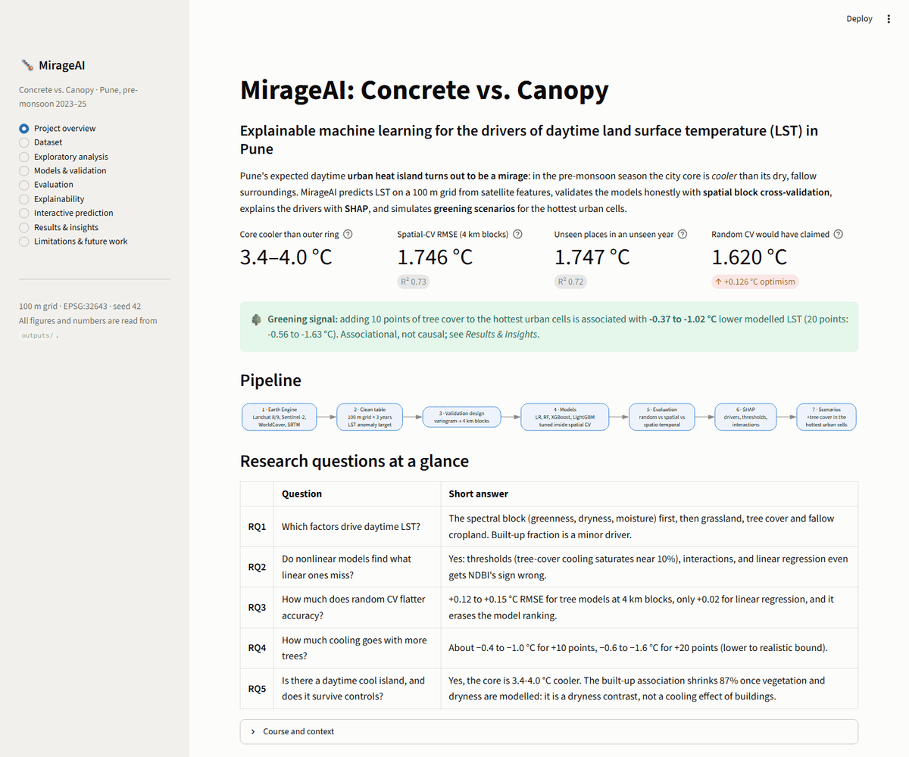
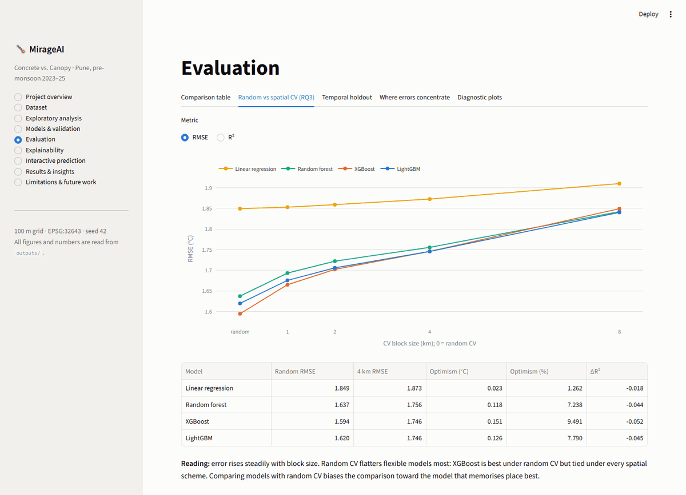
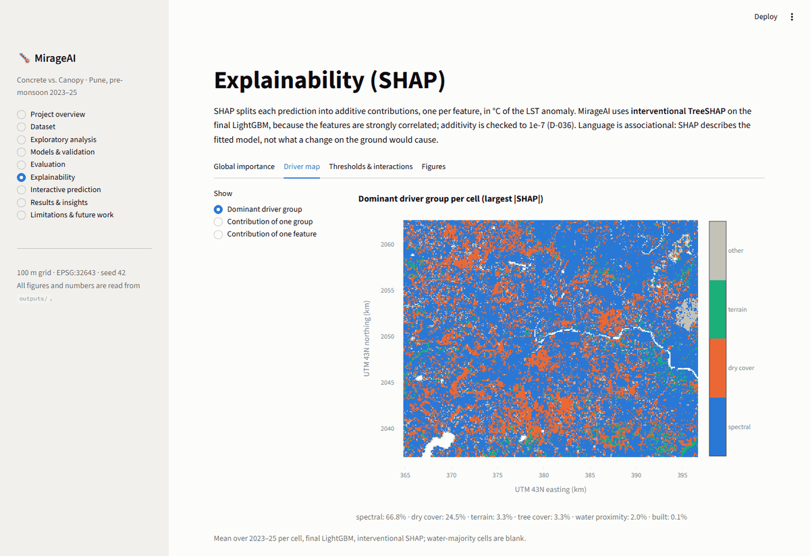
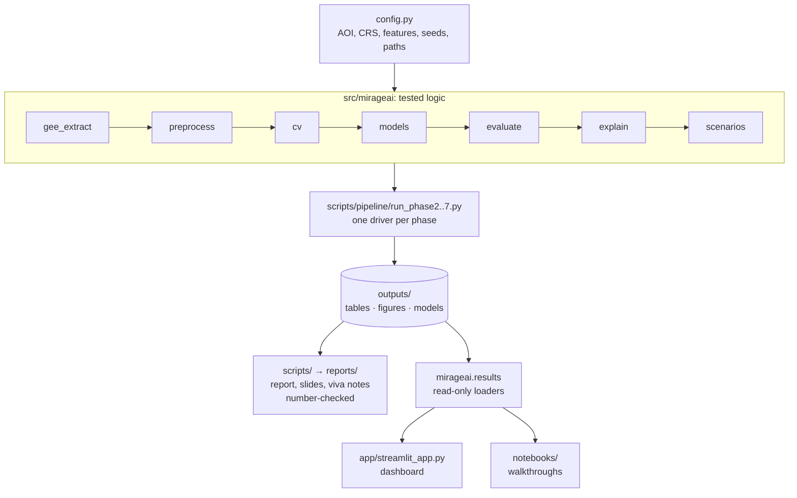
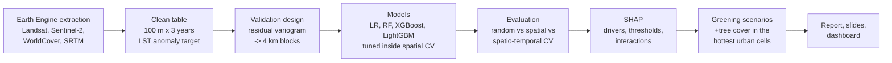

<div align="center">

# MirageAI: Concrete vs. Canopy

**Explainable machine learning for the drivers of urban heat in Pune, India**

[](https://www.python.org/)
[](https://scikit-learn.org/)
[](https://lightgbm.readthedocs.io/)
[](https://xgboost.readthedocs.io/)
[](https://shap.readthedocs.io/)
[](https://streamlit.io/)
[](https://earthengine.google.com/)
[](tests/)
[](#evaluation)
[](LICENSE)

*Pune's daytime urban heat island turns out to be a mirage: in the pre-monsoon
season the city core is **cooler** than its dry surroundings. MirageAI measures
it, explains it, and asks how much more tree cover would help.*

[Quick Start](#quick-start) · [Project Demo](#project-demo) · [Results](#results) · [Dashboard](#dashboard) · [Docs](docs/README.md)

</div>



---

## Contents

1. [Overview](#overview)
2. [Problem statement](#problem-statement)
3. [Motivation](#motivation)
4. [Key features](#key-features)
5. [Quick Start](#quick-start)
6. [Project Demo](#project-demo)
7. [Results](#results)
8. [Architecture](#architecture)
9. [ML pipeline](#ml-pipeline)
10. [Dashboard](#dashboard)
11. [Data](#data)
12. [Models](#models)
13. [Evaluation](#evaluation)
14. [Installation](#installation)
15. [Usage](#usage)
16. [Reproducibility](#reproducibility)
17. [Repository structure](#repository-structure)
18. [Limitations](#limitations)
19. [Future work](#future-work)
20. [Documentation](#documentation)
21. [Acknowledgements](#acknowledgements)
22. [Contributors](#contributors)
23. [License](#license)

---

## Overview

MirageAI predicts daytime **land surface temperature (LST)** for every 100 m
cell of Pune from satellite data: Sentinel-2 spectral indices, ESA WorldCover
land-cover fractions and SRTM terrain. It then:

* **validates honestly** with spatial block cross-validation, so the reported
  accuracy is for places the model has never seen;
* **explains** what drives the temperature with SHAP, including thresholds and
  interactions a linear model misses;
* **simulates greening**: how much cooler the model expects the hottest urban
  cells to be with more tree cover.

All of this ships with a nine-page interactive **Streamlit dashboard**, a
report, a slide deck, and an automatic check that every number in them matches
the results tables.

> Academic case study for *Applications and Use Cases of Machine Learning*
> (TE7483), Symbiosis Institute of Technology, Pune. Smart Cities theme;
> UN SDG 11 (sustainable cities) and SDG 13 (climate action).

| | |
|---|---|
| **Study area** | Pune and Pimpri-Chinchwad, ~800 km², 81,983 cells of 100 m |
| **Period** | Pre-monsoon (March–May) 2023, 2024 and 2025 |
| **Target** | LST anomaly: a cell's temperature minus that year's city-wide median (°C) |
| **Features** | 13: three spectral indices, seven land-cover fractions, distance to water, elevation, slope |
| **Models** | Mean baseline, linear regression, random forest, XGBoost, LightGBM |
| **Headline** | RMSE **1.746 °C**, R² **0.73** on unseen 4 km blocks; **1.747 °C**, R² **0.72** on unseen blocks in the unseen year 2025 |

## Problem statement

Cities are replacing vegetation and water with concrete, and this is expected
to make them hotter. Most urban heat island (UHI) studies share two weaknesses:

1. **Linear, single-index analysis.** They correlate LST with one index
   (usually NDVI) and so miss thresholds, saturation and interactions between
   drivers.
2. **Inflated accuracy.** They validate with random train/test splits.
   Neighbouring pixels are almost identical, so test pixels leak information
   from training pixels and the reported accuracy is overstated.

MirageAI addresses both: nonlinear models explained with SHAP, validated with
spatial and spatio-temporal block cross-validation.

**Research questions**

| | Question |
|---|---|
| RQ1 | Which land-cover and terrain factors drive daytime LST, and how strongly? |
| RQ2 | Do nonlinear models capture effects linear models miss? |
| RQ3 | How much does random CV overstate performance compared with spatial block CV? |
| RQ4 | How much cooling is associated with realistic increases in tree cover in the hottest cells? |
| RQ5 | Is there a daytime surface urban *cool* island, and does the negative built-up–LST association survive controls for vegetation and dryness? |

## Motivation

* **Heat is a public-health and planning problem.** Indian cities face
  longer and hotter pre-monsoon seasons, and greening budgets need to go where
  they cool the most.
* **"Plant more trees" needs a number and a place.** A city needs to know
  *which* neighbourhoods are hottest, *why*, and *how much* a realistic amount
  of canopy is associated with.
* **Spatial ML is easy to get wrong.** Random cross-validation on map data
  reports accuracy that does not survive contact with a new neighbourhood. This
  project measures that optimism directly and reports the honest number.
* **Explanations must survive scrutiny.** The project's conclusions rest on
  explanations that are checked across models and SHAP methods, not on a single
  feature-importance chart.

## Key features

| | |
|---|---|
| 🛰️ **Multi-source satellite dataset** | Landsat 8/9 thermal, Sentinel-2, ESA WorldCover and SRTM, cloud-masked and aggregated onto one 100 m grid in Google Earth Engine |
| 🧱 **Leakage-proof validation** | Spatial block CV with blocks sized from the residual autocorrelation range, repeated over five random layouts; a spatio-temporal test on unseen places in an unseen year |
| ⚖️ **Fair model comparison** | Five models on identical folds with paired differences; all preprocessing and tuning inside the folds (sklearn `Pipeline`) |
| 🔍 **Explainability** | Interventional TreeSHAP on correlated features, grouped drivers, per-cell driver maps, thresholds and interactions, cross-checked between LightGBM and XGBoost |
| 🌳 **Greening scenarios** | Tree-cover scenarios for the hottest urban cells, bracketed between a lower and a realistic bound and averaged over three models |
| 📊 **Interactive dashboard** | Nine Streamlit pages, including live predictions with a per-feature breakdown and a tree-cover what-if |
| ✅ **Verified communication** | The report, slides and viva notes are checked number by number against the results tables (376 checks) |
| 🔁 **One-command reproducibility** | Pinned environment, fixed seeds, CPU-only models, and one script from raw data to the final report |

---

## Quick Start

You need **Python 3.11 or newer** and Git. Everything else, including the
dashboard, comes from `requirements.txt`.

```bash
git clone https://github.com/shourya-tiwari/MirageAI.git MirageAI
cd MirageAI

python -m venv .venv
.venv\Scripts\activate            # Windows
# source .venv/bin/activate       # macOS / Linux

python -m pip install --upgrade pip
pip install -r requirements.txt
pip install -e .

streamlit run app.py
```

(From the submission zip, unzip it and start at `cd MirageAI`.)

The dashboard opens at <http://localhost:8501> and reads the results already in
`outputs/`, so it works straight after cloning; nothing has to be recomputed.

**Optional next steps**

```bash
python -m pytest -q                         # run the test suite
python scripts/pipeline/run_all.py          # rebuild every result (needs data/raw, ~1 h)
```

| After… | You will find |
|---|---|
| cloning | results tables in `outputs/tables/`, figures in `outputs/figures/`, the report, slides and viva notes in `reports/` |
| `run_all.py` | the clean table in `data/processed/`, fitted models in `outputs/models/`, rebuilt tables and figures, `reports/MirageAI_Report.pdf` and `reports/MirageAI_Slides.pdf`, timings in `outputs/run_all_log.csv` |

> **Notes.** The results were produced on Python 3.11.15; this setup was
> verified from a fresh `.venv` on Python 3.13.15 (Windows). On Windows, keep the repository at a short path (for example `D:\MirageAI`):
> some Jupyter files exceed the default 260-character path limit inside long
> folder names. A few dashboard views need files the repository does not include
> (the raw data for the interactive maps, the fitted model for live
> predictions); they show the saved figures instead and say which script
> creates the missing file.

---

## Project Demo

A five-minute walkthrough for a viva or a faculty evaluation.

**Before you start:** launch the dashboard and leave it open on *Project overview*.

```bash
streamlit run app.py
```

| Time | Dashboard page | Show | Say |
|---|---|---|---|
| 0:00–0:45 | **Project overview** | The four metric cards and the green greening banner | "We expected an urban heat island. The data shows the opposite: the core is 3.4–4.0 °C *cooler* than the outer ring, because the fringe is dry, bare and fallow." |
| 0:45–1:45 | **Evaluation → Random vs spatial CV (RQ3)** | The RMSE-vs-block-size curve and the optimism table | "Random CV would have reported 1.62 °C. On unseen 4 km blocks the honest error is 1.75 °C, and it keeps rising with block size. Random CV also makes XGBoost look best; under spatial CV the three tree models are tied." |
| 1:45–2:45 | **Explainability → Global importance**, then **Driver map** | Grouped drivers bar; the per-cell map | "Greenness, dryness and surface moisture dominate (1.49 °C mean \|SHAP\|). Built-up fraction ranks 10th of 13. The map shows where each driver dominates: spectral in 67% of cells, dry cover in 25%." |
| 2:45–3:45 | **Interactive prediction** | Preset *Hot tree-less fringe*; move *Add tree cover* to 10 | "The model predicts this cell about 2.2 °C hotter than the city median. The bars show why: dryness and no tree cover push it up. Adding 10 points of trees lowers the prediction. This is the model's association, not a planting forecast." |
| 3:45–4:30 | **Results & insights** | The scenario bracket chart | "For the 2,673 hottest urban cells: −0.37 to −1.02 °C for +10 points of tree cover, −0.56 to −1.63 °C for +20 points. Gains per point roughly halve past about 10% cover." |
| 4:30–5:00 | **Limitations & future work** | The caveat list | "Surface, not air, temperature; associational, not causal; one city, one season. Next: building height and irrigation features." |

**Most important visualisations:** the RMSE-vs-block-size curve (the
methodological contribution), the dominant-driver map (the explanation), and the
scenario bracket (the policy answer).

**Conclusions to state:**
1. Pune has a daytime surface *cool* island, driven by the dry, fallow fringe,
   not by cooling from buildings.
2. Random CV overstates accuracy by 0.12–0.15 °C RMSE for tree models and
   changes which model looks best; spatial block CV is required for map data.
3. Vegetation, dryness and moisture explain far more than built-up share.
4. Tree cover is associated with up to about 1 °C of cooling for +10 points,
   with diminishing returns past about 10% cover.

**If something fails during the demo:** every chart also exists as a figure in
`outputs/figures/` (for example `05_cv_gap.png`, `06_dominant_driver_map.png`,
`09_scenario_bracket.png`), and `reports/MirageAI_Slides.pdf` tells the same
story.

**Deliverables:** `reports/MirageAI_Report.pdf` is a 15-page IEEE-format
conference paper (editable copy: `MirageAI_Report.docx`; source:
`reports/report.md`). `reports/MirageAI_Slides.pptx` / `.pdf` is a 19-slide deck
for a 10–15 minute viva, with speaker notes on every slide naming the presenter. `reports/viva_prep.md` lists the checked numbers to know and 33 likely
questions with answers.

---

## Results

| Question | Answer |
|---|---|
| Is there a daytime urban heat island? | **No, it is inverted.** The core is **3.4–4.0 °C cooler** than the outer ring in all three years (land cells). |
| How accurate is the model on places it has never seen? | **RMSE 1.746 ± 0.060 °C, R² 0.73** under 4 km spatial block CV; **1.747 °C, R² 0.72** on unseen blocks in the unseen year 2025 (LightGBM; the three tree models are tied). |
| How much would random CV have flattered it? | +0.12 to +0.15 °C RMSE for the tree models, only +0.02 °C for linear regression, and it changes the model ranking. |
| What drives daytime LST? | Greenness, dryness and surface moisture (the spectral block, 1.49 °C mean \|SHAP\|), then grassland, tree cover and fallow cropland. Built-up fraction ranks 10th of 13. |
| How much cooling goes with more trees? | In the 2,673 hottest urban cells: **−0.37 to −1.02 °C** for +10 points of tree cover, **−0.56 to −1.63 °C** for +20 points (lower to realistic bound). Associational, not causal. |

**Accuracy by validation scheme** (LightGBM, mean over 25 runs)

| Scheme | RMSE (°C) | R² |
|---|---|---|
| Random CV (optimistic reference) | 1.620 | 0.78 |
| Spatial, 1 km blocks | 1.675 | 0.76 |
| Spatial, 2 km blocks | 1.706 | 0.75 |
| **Spatial, 4 km blocks (headline)** | **1.746 ± 0.060** | **0.73** |
| Spatial, 8 km blocks (conservative) | 1.840 | 0.69 |
| **Spatio-temporal: unseen blocks in 2025** | **1.747** | **0.72** |

**Model comparison at 4 km blocks:** LightGBM 1.746, XGBoost 1.746, random
forest 1.756, linear regression 1.873, mean baseline 3.451 °C. The tree models
differ by a few thousandths of a degree on identical folds: a tie. LightGBM is
the reference model because it is lowest on the clean 2025 test and cheapest to
explain.

**Further findings**
* Among urban cells, the model finds **54.2%** of the observed hottest decile
  (chance: 10%).
* The built-up–LST association shrinks by **87%** once vegetation and dryness
  are modelled: the cool island is a dryness contrast, not a building effect.
* Tree-cover cooling **saturates** near 10% cover; linear regression gets the
  sign of NDBI wrong because the indices are collinear.
* 78.7% of the scenario target cells have no tree cover at all. The jump from
  none to some is reported separately and left out of the headline, because it
  reflects what tree-less places *are*, not what a tree does.

Every number in this README is read from `outputs/tables/` and checked against
the report, slides and viva notes by `scripts/check_report_numbers.py`. The
full write-up is `reports/MirageAI_Report.pdf`.

<table>
<tr>
<td width="50%"><br><sub><b>RQ3.</b> Error rises with block size; random CV flatters flexible models most.</sub></td>
<td width="50%"><br><sub><b>RQ1.</b> Dominant driver group per 100 m cell: spectral (blue) and dry cover (orange).</sub></td>
</tr>
</table>

---

## Architecture

The code is layered: constants in one place, logic in a tested package, thin
scripts that run each phase, and read-only views on top.



| Layer | Where | Rule |
|---|---|---|
| Configuration | `src/mirageai/config.py` | The single source of every constant: area, CRS, grid, years, feature lists, forbidden columns, seed, paths |
| Logic | `src/mirageai/*.py` | Pure functions, one module per phase, covered by `tests/` |
| Drivers | `scripts/pipeline/` | Run a phase top to bottom and write its outputs; no reusable logic |
| Outputs | `outputs/` | Every result as CSV, parquet, PNG or joblib |
| Views | `app/`, `notebooks/`, `reports/` | Read the outputs, never recompute them |

## ML pipeline



| Phase | What happens | Module | Driver |
|---|---|---|---|
| 1 | Cloud-masked median composites aggregated onto the 100 m grid | `gee_extract.py` | notebook `01` |
| 2 | Merge years, stable cell and block ids, LST anomaly target, urban flag, EDA, VIF | `preprocess.py` | `run_phase2.py` |
| 3 | Variogram, spatial blocks, splitters, leakage tests | `cv.py` | `run_phase3.py` |
| 4 | Water exclusion, tuning inside spatial CV, out-of-fold predictions for 5 models × 8 schemes | `models.py` | `run_phase4.py` |
| 5 | Model comparison, CV gap, temporal holdout, subgroup errors, Moran's I | `evaluate.py` | `run_phase5.py` |
| 6 | Interventional TreeSHAP, driver groups, thresholds, interactions | `explain.py` | `run_phase6.py` |
| 7 | Target cells, tree-cover scenarios, index models, support guard | `scenarios.py` | `run_phase7.py` |
| 8 | Report, slides and viva notes, every number checked against the tables | `scripts/` | `run_all.py` |

Drivers are in `scripts/pipeline/`; `run_all.py` runs phases 2–8 in order.

---

## Dashboard

```bash
streamlit run app.py
```

| Page | What you see |
|---|---|
| **Project overview** | The finding in one line, headline metric cards, the pipeline and a one-line answer per research question |
| **Dataset** | Sources, the feature dictionary, cleaning steps, the water exclusion, and (with `data/`) a preview of the clean table |
| **Exploratory analysis** | Interactive LST, anomaly, NDVI and land-cover maps per year, the cool-island curve, correlations (all vs urban cells) |
| **Models & validation** | Why each model is there, how the blocks were sized, the five-layout CV design and the tuned hyperparameters |
| **Evaluation** | Model × scheme table, the RMSE-vs-block-size curve (RQ3), the 2025 holdout, urban vs rest, hottest-decile detection, residual Moran's I |
| **Explainability** | SHAP importance (LightGBM vs XGBoost, all vs urban), grouped drivers, an interactive per-cell driver map, thresholds and interactions |
| **Interactive prediction** | Sliders describe a cell; the final LightGBM predicts its LST anomaly, breaks it down by feature, and shows the effect of adding tree cover |
| **Results & insights** | The scenario bracket, the dose–response curve and the key findings |
| **Limitations & future work** | Caveats, next steps, and downloads of the report, slides and viva notes |

The dashboard is **read-only**: it reads the same tables the report is checked
against, so it cannot disagree with the report. Design notes are in
[`docs/DASHBOARD.md`](docs/DASHBOARD.md).

<p align="center">
<br>
<sub>Interactive prediction: a live LightGBM prediction with its per-feature breakdown and a tree-cover what-if.</sub>
</p>

---

## Data

| Source (via Google Earth Engine) | Used for |
|---|---|
| Landsat 8/9 Collection 2 Level-2 (`ST_B10`) | Target: land surface temperature |
| Sentinel-2 SR Harmonized | NDVI (greenness), NDBI (dryness), MNDWI (surface moisture) |
| ESA WorldCover v200 (2021) | Fractions of tree, shrub, grass, crop, built-up, bare and water; distance to water |
| SRTM | Elevation, slope |

| | |
|---|---|
| Area | PMC + PCMC core, lon 73.72–74.02, lat 18.42–18.65 |
| Grid | 100 m (the Landsat thermal band's native resolution), EPSG:32643 (UTM 43N) |
| Years | 2023 and 2024 for training, 2025 for the temporal test |
| Size | 81,983 cells × 3 years = 245,949 rows; 243,252 after removing water-majority cells |

Coordinates are **never** model features; they are used only to build spatial
blocks and draw maps (asserted in `config.py`).

**Getting the raw data.** `data/` is not in the repository. The pipeline's input
is three CSVs in `data/raw/` (`uhi_pune_2023.csv`, `uhi_pune_2024.csv`,
`uhi_pune_2025.csv`), extracted by `src/mirageai/gee_extract.py`. With an Earth
Engine account (see [Installation](#installation)):

```bash
python -c "from mirageai import gee_extract as g; g.init_ee(); [print(g.extract_year(y)) for y in (2023, 2024, 2025)]"
```

Each call downloads that year's GeoTIFF stack into `data/raw/` and writes the
CSV. A re-run reproduced the stored extraction exactly; since Earth Engine
collections can be reprocessed over time, the team keeps the CSVs behind the
reported results as the reference copy.

## Models

| Model | Role | Features | Tuned hyperparameters |
|---|---|---|---|
| Mean baseline | Sanity floor | – | `DummyRegressor` |
| Linear regression | The linear status quo | 12 | `StandardScaler` + OLS in a `Pipeline`; drops `frac_built` because the fractions sum to 1 |
| Random forest | Bagging ensemble | 13 | 200 trees, depth 16, `min_samples_leaf` 2, `max_features` 0.3 |
| XGBoost | Gradient boosting | 13 | 1,200 trees, depth 8, learning rate 0.01; `hist`, CPU only |
| LightGBM | Gradient boosting; **reference model** | 13 | 1,200 trees, 63 leaves, learning rate 0.01 |

Tuning uses `RandomizedSearchCV` (25 candidates per model, scored on RMSE)
inside 4 km spatial block folds on 2023–24 only, so the 2025 test year is never
seen during selection. The selected hyperparameters are in
`outputs/tables/phase4_tuning_*.csv` and Table IV of the report.

## Evaluation

| Metric | Why |
|---|---|
| **RMSE (°C)**, primary | Error in the target's own unit; penalises large misses |
| MAE (°C) | Typical error, robust to outliers |
| R² | Share of variance explained, comparable across schemes |
| Paired differences | Model vs model on identical folds, so a tie is visible as a tie |
| Hottest-decile detection | Does the model find the cells a city would act on? |
| Residual Moran's I | How much spatial structure is still unexplained |

* **Reporting:** mean ± std over 25 runs (5 random block-to-fold layouts × 5 folds).
* **Schemes:** random CV (grouped by cell, to measure inflation); spatial block
  CV at 1, 2, **4** and 8 km; spatio-temporal CV (train 2023–24 on some blocks,
  test 2025 on the others). A latitude-strip layout is kept as a stress test.
* **Block size:** set from the autocorrelation range of model *residuals*
  (~3.7–4.0 km), not of the raw target (7.65 km), because the features already
  explain the regional gradient (D-028). The 8 km result is reported as the
  conservative bound.

---

## Installation

**Requirements:** Python **3.11 or newer** and about 2 GB of disk for the
environment. Everything runs on the CPU; the full pipeline was developed and
timed on a 16 GB laptop.

```bash
python -m venv .venv
.venv\Scripts\activate            # Windows  (macOS / Linux: source .venv/bin/activate)
python -m pip install --upgrade pip
pip install -r requirements.txt
pip install -e .
```

Run the install from the repository root; the rest of this README assumes the
environment is active.

**What the files contain (D-055).** `requirements.txt` lists only the 23
packages the project uses directly (the 21 it imports, pytest included, plus
JupyterLab and ipykernel for the notebooks), pinned to the versions the results were produced
with; pip resolves their dependencies. `pip install -e .` then installs the
`mirageai` package itself in editable mode, so `import mirageai` works from the
scripts, tests, notebooks and dashboard. `requirements-lock.txt` pins the whole
resolved environment; install from it instead
(`pip install -r requirements-lock.txt`, then `pip install -e .`) to rebuild it
exactly.

**Outside Python, only for rebuilding the report and slides:** pandoc
(`winget install JohnMacFarlane.Pandoc`), Chrome or Edge (prints the report
PDF), and Microsoft PowerPoint (exports the slides PDF).

### Earth Engine (only to re-extract `data/raw/`)

1. Register a noncommercial Earth Engine Cloud project at <https://code.earthengine.google.com>.
2. Authenticate once: `earthengine authenticate`
3. Set the project ID as `GEE_PROJECT` in `src/mirageai/config.py`, or set the environment variable `MIRAGEAI_GEE_PROJECT`.
4. Check: `python -c "from mirageai.gee_extract import init_ee; init_ee()"`

## Usage

```bash
streamlit run app.py                             # the dashboard
python -m pytest -q                              # the test suite
python scripts/pipeline/run_all.py               # everything: Phase 2 -> 7, figures, report, slides, checks
python scripts/pipeline/run_all.py --from 6      # resume at a step
python scripts/pipeline/run_phase5.py            # or run one phase
python scripts/check_report_numbers.py           # re-check every number in the report, slides and viva notes
python scripts/make_submission.py                # build MirageAI_Final_Submission.zip
```

* `run_all.py` runs each step in its own process and stops at the first
  failure; `--from N` resumes there. A full run takes about an hour on a 16 GB
  laptop (Phase 4 tuning and Phase 6 SHAP are the long steps). Steps 9 and 10
  build the report and slides and need pandoc, Chrome or Edge, and
  PowerPoint; the phases and figures before them do not.
* Tests that need `data/` or the out-of-fold predictions are skipped, with the
  script to run, until those exist.
* The notebooks in `notebooks/` are short, executed walkthroughs that call
  `src/mirageai` and show the stored tables and figures.

## Reproducibility

| Mechanism | Effect |
|---|---|
| Pinned `requirements.txt`, full `requirements-lock.txt` | The direct dependencies at the versions the results were produced with; the lock pins the whole environment |
| Seed 42 everywhere (42–46 for CV layouts) | Deterministic splits, sampling and models |
| CPU-only tree models | Bit-identical predictions across reruns and machines (D-031) |
| One entry point (`scripts/pipeline/run_all.py`) | One command from `data/raw/` to the PDF report (D-048) |
| Number checker (`scripts/check_report_numbers.py`) | The report, slides and viva notes cannot disagree with the tables |
| `config.py` as the single source of constants | No magic numbers scattered through scripts |
| Tests (`tests/`, 114) | Guard leakage, block consistency, additivity of SHAP, fractions summing to one, the dashboard's summaries |

The Quick Start was rerun from a freshly created `.venv` on Python 3.13.15:
the install completes with no conflicts (`pip check`), the tests pass, the
fitted models load and the dashboard serves all nine pages (D-055). Earlier, on
a clean copy with empty `outputs/` (Python 3.11.15): `scripts/pipeline/run_all.py` reproduces the Phase
2–3 outputs byte for byte, and the Phase 4 tuning and the cross-validation runs
it reached exactly (D-052).

## Repository structure

```
MirageAI/
├── README.md                  you are here
├── project_deep_dive.md       technical guide: what, why, how, when, where for every component
├── learning_log.md            beginner-to-advanced study guide with viva and interview questions
├── app.py                     dashboard launcher: streamlit run app.py
├── requirements.txt           direct dependencies, pinned
├── requirements-lock.txt      the full resolved environment, for an exact rebuild
├── pyproject.toml             package metadata
├── LICENSE                    MIT
├── CITATION.cff               how to cite the project
├── app/
│   └── streamlit_app.py       interactive dashboard (read-only over outputs/)
├── src/mirageai/              the pipeline package
│   ├── config.py              single source of truth: AOI, CRS, features, seeds, paths
│   ├── gee_extract.py         Phase 1: Earth Engine extraction
│   ├── preprocess.py          Phase 2: clean table, ids, target, VIF
│   ├── cv.py                  Phase 3: variogram, blocks, splitters
│   ├── models.py              Phase 4: model zoo, search spaces, tuning, OOF predictions
│   ├── evaluate.py            Phase 5: metrics and diagnostics
│   ├── explain.py             Phase 6: SHAP and threshold finder
│   ├── scenarios.py           Phase 7: greening scenarios
│   ├── plotting.py            shared map helpers
│   └── results.py             read-only access to outputs (dashboard, notebooks)
├── scripts/
│   ├── pipeline/              run_all.py and one driver per phase (run_phase2.py … run_phase7.py)
│   └── *.py                   report and slide figures and builds, number and reference checks, zip
├── notebooks/                 thin walkthroughs that call src/ and show stored results
├── tests/                     leakage, hygiene and method guards (pytest)
├── docs/                      project docs, decision log, screenshots (index: docs/README.md)
├── data/                      raw Earth Engine exports and the clean table (not in the repo)
├── outputs/                   tables and figures (fitted models and OOF predictions are regenerated)
└── reports/                   report, slides, viva notes and their sources
```

---

## Limitations

* LST is the **surface** temperature at a ~10:30 AM satellite overpass, not the
  air temperature people feel.
* Scenario results are **associations** from a predictive model, not causal
  effects of planting trees.
* Residual Moran's I ≈ 0.6: neighbouring cells share errors the features cannot
  explain (building height, roofing material, irrigation).
* WorldCover is a 2021 snapshot used for all three years.
* NDVI, NDBI and MNDWI are collinear; only their combined contribution is
  ranked with confidence.
* One city, one season, daytime only.

## Future work

* Urban-form features (building height and density, roof albedo) and irrigation proxies.
* Neighbourhood (focal) features to model heat spreading between cells.
* Night-time and seasonal LST, to test whether the cool island flips.
* Air-temperature sensors, to connect surface heat to thermal comfort.
* Causal designs: before/after studies of real planting programmes.
* Nested spatial CV, to remove the small optimism from tuning on the evaluation folds.
* The realistic-bound greening scenario as a live control in the dashboard.

## Documentation

| File | Read it for |
|---|---|
| [`project_deep_dive.md`](project_deep_dive.md) | How every component works and why, in enough detail to rebuild the project |
| [`learning_log.md`](learning_log.md) | A structured course on the concepts, with interview and viva questions |
| [`docs/README.md`](docs/README.md) | Index of the project docs |
| [`docs/DECISIONS.md`](docs/DECISIONS.md) | Every non-obvious choice (D-001 onward), each with a viva one-liner |
| [`docs/INSTRUCTIONS.md`](docs/INSTRUCTIONS.md) | Repository rules and the ML hygiene rules |
| [`docs/DASHBOARD.md`](docs/DASHBOARD.md) | How the dashboard is built |
| [`reports/MirageAI_Report.pdf`](reports/MirageAI_Report.pdf) | The full write-up, as an IEEE-format conference paper |
| [`reports/viva_prep.md`](reports/viva_prep.md) | Checked numbers to know and 33 viva questions with answers |

**Methodological commitments**
* Coordinates (`lon`, `lat`, `x_utm`, `y_utm`) are never model features.
* Spatial block CV is the headline metric; random CV is reported only to measure its inflation.
* All preprocessing and tuning happens inside the CV folds.
* The 2025 test year is never used for tuning.
* Seed 42 everywhere; CPU only, so reruns reproduce predictions bit for bit.

## Acknowledgements

* **Course:** *Applications and Use Cases of Machine Learning* (TE7483),
  Symbiosis Institute of Technology, Pune, and its faculty.
* **Data:** USGS Landsat 8/9 Collection 2; ESA Copernicus Sentinel-2; ESA
  WorldCover v200; NASA SRTM; all accessed through Google Earth Engine.
* **Methods:** spatial block cross-validation following Roberts et al. (2017);
  SHAP following Lundberg & Lee (2017). Full references are in the report.
* **Open source:** scikit-learn, LightGBM, XGBoost, SHAP, pandas, NumPy,
  libpysal/esda, rasterio, matplotlib, Plotly and Streamlit.

## Contributors

MirageAI was built by a team of four at the Symbiosis Institute of Technology, Pune:

| Name |
|---|
| **Shourya Tiwari** |
| **Shashwat Kumar** |
| **Rishik Sinha** |
| **Shubhankar Bhan** |

To cite the project, see [`CITATION.cff`](CITATION.cff).

## License

Released under the [MIT License](LICENSE). © 2026 Shourya Tiwari.

The satellite data products used here keep their own terms: Landsat and SRTM
are public-domain USGS/NASA data, and Sentinel-2 and ESA WorldCover are
available under the Copernicus and CC BY 4.0 licences respectively.
