# Introduction

Indian cities are warming, and municipal heat action plans increasingly ask a
practical question: where would greening reduce heat the most? Satellite land
surface temperature (LST) is the usual evidence base for that question, because
it is free, wall-to-wall and repeatable. LST is a *surface* temperature,
however, not air temperature or thermal comfort [1], and the maps that
machine learning (ML) models produce from it are easy to over-trust.

Two weaknesses recur in the urban heat island (UHI) literature. The first is
*single-index, linear analysis*: LST is correlated with one vegetation or
built-up index, which hides thresholds, saturation and interactions between
drivers [2]. The second is *inflated accuracy*: neighbouring cells are
almost identical, so a model validated on randomly held-out cells can score
well by recognising places it has effectively seen in training. That gap
between apparent and real accuracy has been demonstrated repeatedly in spatial
ecology [3], [4], [5].

This paper presents *MirageAI*, a reproducible pipeline for Pune, India, that
addresses both weaknesses. The name reflects the main finding: Pune's expected
daytime heat island turns out to be a mirage, with the built core cooler than
its dry surroundings. The pipeline also connects both to a planning question.
Its
contributions are:

- a 100 m, three-year, multi-source modelling table for the pre-monsoon season,
  built entirely in Google Earth Engine [6];
- a validation design whose block size is set from the *residual*
  autocorrelation range, with randomised block layouts repeated over five seeds
  and a spatio-temporal test on unseen places in an unseen year;
- a direct measurement of how much random cross-validation (CV) overstates
  accuracy, showing that the inflation is model-dependent;
- an explanation of the fitted models with interventional SHAP [7],
  [8], checked for robustness across models and SHAP methods, with
  thresholds and interactions quantified;
- bracketed greening scenarios for the hottest urban cells, reported with
  explicit bounds and caveats rather than as forecasts.

Every methodological choice is recorded with its rationale in a decision log,
and every number quoted in this paper is read from the project's output tables
and checked automatically against them. The remainder of the paper reviews the
literature (Section II), states the problem and objectives (Sections III–IV),
describes the method, data, preprocessing, exploratory analysis and features
(Sections V–IX), the models, tuning and metrics (Sections X–XII), and reports
and discusses the results (Sections XIII–XVIII).

# Literature Review

## Surface urban heat islands and their drivers

The surface urban heat island (SUHI) is the difference in LST between a city
and its surroundings. Thermal remote sensing made it observable at city scale,
but LST describes the radiative skin temperature at the satellite overpass,
which depends on surface materials, moisture and view geometry, and differs
from the air temperature people experience [1]. Across 419 large cities,
daytime SUHI intensity is explained mainly by differences in vegetation cover
and evapotranspiration between the city and its surroundings, not by city size
alone [9]. City-scale studies have long used the LST–vegetation
relationship, typically through NDVI, as the main explanatory variable
[2]. Systematic reviews of urban greening find that parks and trees are
associated with cooler surroundings, but most evidence is observational and
site-specific [10].

## Surface heat in Indian cities

Indian cities do not always show the textbook daytime heat island. A national
analysis found that daytime SUHI intensity in many Indian cities is *negative*
in the pre-monsoon summer, with cities cooler than their surroundings, and
associated this with low vegetation and evapotranspiration in dry, non-urban
surroundings; at night and in other seasons the sign flips [11]. Later
multi-year studies of Indian cities confirm strong day–night and seasonal
contrasts in SUHI intensity [12], [13]. Pune lies on the
semi-arid Deccan plateau, with dry grassland, fallow farmland and bare hills
around a built core, which makes it a likely candidate for a daytime cool
island. That expectation is tested here rather than assumed.

## Machine learning for LST mapping

Tree ensembles such as Random Forest [14] and gradient-boosted trees
(XGBoost [15], LightGBM [16]) are now standard for mapping LST
from land cover and spectral indices, because they capture nonlinear responses
and interactions without manual feature design. Their flexibility is also a
risk: with spatially autocorrelated data they can learn place-specific
structure that does not transfer to new areas.

## Spatial validation

Roberts et al. [3] showed that random CV on spatially, temporally or
hierarchically structured data gives over-optimistic error estimates, and
recommended block CV with blocks at least as large as the range of
autocorrelation. Ploton et al. [4] found that large-scale ecological
maps that looked accurate under random CV had little predictive skill under
spatial CV. Meyer et al. [5] showed that spatially aware validation also
changes which predictors appear important. Tools for building spatially
separated folds are now widely available [17]. Most LST studies still
report random-split accuracy, and few measure how large the optimism is for
different model families.

## Explainable machine learning

SHAP values decompose each prediction into additive feature contributions with
game-theoretic guarantees [7]. TreeSHAP computes them exactly for
tree ensembles, and its *interventional* variant, which breaks feature
dependence using a background sample, avoids attributing a correlated
feature's effect to its neighbours in the conditional tree path
[8]. For satellite predictors, which are strongly correlated, the
choice between these variants matters. SHAP explains the fitted model, so its
values are associations within the data, not causal effects.

## Research gap

Taken together, the literature leaves three gaps that this study addresses for
Pune: (i) no spatially validated, explained ML model of pre-monsoon LST at
100 m; (ii) little evidence on how much random CV inflates accuracy for
different model families on the same data; and (iii) no quantified,
bounded estimate of the cooling associated with greening the city's hottest
urban cells.

# Problem Statement

Given satellite-derived land-cover, spectral and terrain features for every
100 m cell of Pune, the task is to predict the cell's pre-monsoon daytime LST
anomaly in places and years the model has not seen, and to explain which
features the predictions depend on. This is a supervised regression problem
on spatially autocorrelated data, with three requirements that standard
practice does not meet together:

1. **Honest accuracy.** Reported error must reflect performance on unseen
   areas, not on neighbours of training cells, so validation must hold out
   whole spatial blocks and a whole year.
2. **Trustworthy explanation.** Driver rankings must be robust to the choice of
   model and SHAP method, and nonlinear effects must be quantified, not
   described.
3. **Actionable, bounded scenarios.** The cooling associated with additional
   tree cover in the hottest urban cells must be stated as a range with its
   assumptions, not as a single forecast.

Geographic coordinates must never be model inputs, because a model that knows
where a cell is can memorise it instead of learning its drivers.

# Objectives

The study answers five research questions (RQs):

- **RQ1.** Which land-cover and terrain factors drive daytime LST in Pune, and
  how strongly?
- **RQ2.** Do nonlinear models capture driver effects that linear models miss
  (thresholds, saturation, interactions)?
- **RQ3.** By how much does random cross-validation overstate performance
  compared with spatial block cross-validation?
- **RQ4.** How much cooling is associated with realistic increases in tree cover
  in the hottest cells?
- **RQ5.** Does Pune show a daytime surface urban cool island in the
  pre-monsoon season, and does the negative built-up–LST correlation vanish once
  vegetation and dryness are controlled for?

The objectives follow directly: (O1) build a clean 100 m modelling table for
three pre-monsoon seasons; (O2) design leakage-proof validation sized from the
measured autocorrelation; (O3) compare four learners and a baseline on
identical folds; (O4) explain the reference model with SHAP and check the
explanation for robustness; and (O5) simulate greening scenarios with explicit
bounds and caveats.

# Methodology

Fig. 1 summarises the pipeline. Data are extracted and composited in Google
Earth Engine (Section VI) and aggregated onto a common 100 m grid; the clean
table carries a within-year LST anomaly target and 13 features
(Sections VII–IX). The validation design is fixed before any model is tuned:
block size comes from a residual variogram, and blocks are dealt to folds at
random over five seeds (Section X). Four learners and a baseline are tuned
inside spatial CV and evaluated under random, spatial and spatio-temporal
schemes (Sections X–XII). The reference model is explained with
interventional SHAP, and greening scenarios are run through three tuned
models with lower and realistic bounds (Section X).

::: wide
{width=86%}
:::

Three engineering rules hold throughout. All preprocessing and tuning happen
inside the CV folds, through scikit-learn pipelines and group-aware splitters
[18]. The 2025 season is never used for model selection. And every
model runs on the CPU with fixed seeds, so reruns reproduce predictions bit for
bit. All constants (area, grid, years, feature lists, seeds) live in one
configuration module, and coordinates are excluded from the feature list by an
assertion.

# Dataset

## Study area

The area of interest is a 73.72–74.02° E, 18.42–18.65° N box covering the Pune
and Pimpri-Chinchwad municipal cores, processed in UTM zone 43N (EPSG:32643) on
a 100 m grid. 100 m matches the native resolution of the Landsat thermal band.
The grid has 81,983 cells in each of 2023, 2024 and 2025 (245,949 cell-years).
The season is pre-monsoon, March to May, when skies are clear and surface heat
peaks.

## Data sources

Table I lists the four sources. All extraction runs in Google Earth Engine
[6], and each year is downloaded as one multi-band GeoTIFF stack and
converted to a table with one row per cell.

- **LST:** Landsat 8 and 9 Collection 2 Level-2 surface temperature
  [19], cloud-masked from the QA band and composited as the seasonal
  median.
- **Spectral indices:** NDVI, NDBI and MNDWI from Sentinel-2 surface
  reflectance [20], with scene-classification masking.
- **Land cover:** fractions of tree, shrub, grass, crop, built-up, bare and
  water in each 100 m cell, from ESA WorldCover 2021 at 10 m [21].
  Land cover is static across the three years.
- **Terrain:** elevation and slope from SRTM [22], and distance to water.

| Source | Product | Native resolution | Used for |
|---|---|---|---|
| Landsat 8/9 | Collection 2 Level-2, band ST_B10 | 100 m (thermal) | Target: LST |
| Sentinel-2 | Surface reflectance, harmonized | 10–20 m | NDVI, dryness, moisture |
| ESA WorldCover | v200, 2021 | 10 m | Seven land-cover fractions; distance to water |
| SRTM | 1 arc-second DEM | 30 m | Elevation, slope |

: Table I. Data sources, all accessed through Google Earth Engine.

Fig. 2 shows the 2024 composite. The river corridors and reservoirs are the
coolest surfaces, and the dry hills and fringe are the hottest.

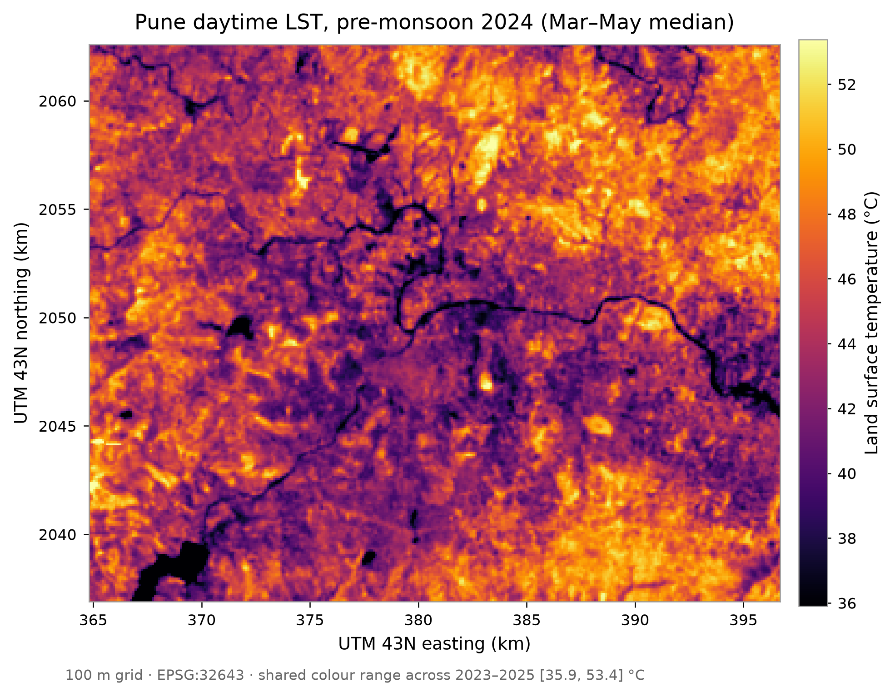{width=100%}

## Dataset summary

Every cell has at least four clear Landsat observations in every season (median
7, 10 and 9 observations in 2023, 2024 and 2025), so no cell is dropped for
missing data. The city-wide median LST is 46.10, 44.31 and 44.81 °C in the
three years; a third of land cells (33%) are urban (built-up fraction ≥ 50%),
and 42.6% of land cells contain no WorldCover tree pixel at all. Table II
gives the per-year figures after water exclusion. The land cover and the urban
mask are static, so the 26,726 urban cells are the same cells in every year.

| Year | Land cells | Median clear scenes | Area median LST (°C) | Anomaly SD (°C) | Anomaly 5th–95th pct. (°C) | Mean NDVI |
|---|---|---|---|---|---|---|
| 2023 | 81,084 | 7 | 46.10 | 3.67 | −5.61, +6.41 | 0.265 |
| 2024 | 81,084 | 10 | 44.31 | 3.23 | −4.83, +5.67 | 0.255 |
| 2025 | 81,084 | 9 | 44.81 | 3.37 | −5.23, +5.74 | 0.261 |

: Table II. Per-year summary of the modelling table (land cells; the area median LST is taken over all cells, as in the target).

# Data Preprocessing

**Scaling and masking.** Landsat ST_B10 digital numbers are converted to
kelvin with the Collection 2 scale factor (0.00341802) and offset (149.0), then
to °C. Pixels flagged as cloud, dilated cloud, cirrus or cloud shadow in
QA_PIXEL are masked, as are Sentinel-2 pixels in the scene-classification
classes for cloud shadow, cloud (medium and high probability), cirrus and snow.
Scenes with more than 30% cloud are skipped. Masked pixels are written with an
explicit nodata sentinel, so a missing value can never be read as zero.

**Compositing and aggregation.** Each source is reduced to a seasonal median
per pixel and then aggregated to the 100 m grid with an area-weighted mean.
WorldCover classes are converted to binary masks before averaging, so each
land-cover feature is the *fraction* of the cell in that class, and the seven
fractions sum to one. Distance to water is computed on a 30 m grid from the
WorldCover water class.

**Stable identifiers.** A cell identifier and its 1, 2, 4 and 8 km block
identifiers are computed from the UTM coordinates alone, never from the year,
so the 2023, 2024 and 2025 copies of a cell always fall in the same block and
therefore the same fold. A test asserts this for every cell. An early version
that rounded half-cell offsets merged adjacent columns; the test caught it and
the identifiers now use `floor`.

**Target.** The target is the within-year anomaly
$\text{LST}_{\text{anom}}$: each cell's LST minus that year's median over the
whole area,

::: eq
$$\text{LST}_{\text{anom},i,y} = \text{LST}_{i,y} - \operatorname{median}_{j}\,\text{LST}_{j,y}.$$
:::

Absolute LST differs between years because of scene timing and weather, and no
feature encodes the year, so the level is not learnable and would only add
noise to the 2025 test.

**Water exclusion.** Cells whose area is at least 50% water are removed before
any split: 899 cells in each year, 2,697 of 245,949 rows, none of them urban.
That leaves 243,252 rows (81,084 per year). Reservoir LST is governed by the
thermal inertia of water, not by land-surface drivers, and water is not a
planning lever. Water fraction and distance to water remain as features. The
anomaly keeps its whole-area median: a land-only median would shift every
anomaly by only 0.045–0.051 °C.

# Exploratory Data Analysis

**The city is cooler than its surroundings by day.** In all three years the
core (land cells within 5 km of the area's centre) is cooler than the outer ring
(land cells beyond 12 km), by 3.661 °C (2023), 3.382 °C (2024) and 3.970 °C
(2025), and the core is greener: mean NDVI 0.349 against 0.249 in 2024. Fig. 3
shows the same pattern cell by cell. Mean LST anomaly falls by about 2 °C from
the least-built to the most-built cells, rising slightly only in the densest
decile. Dryness is highest in the least-built cells. This matches the daytime
pre-monsoon cool island reported across Indian cities, which Shastri et al.
[11] associate with low vegetation and evapotranspiration in dry
non-urban surroundings; see also [12] and [13].

::: wide
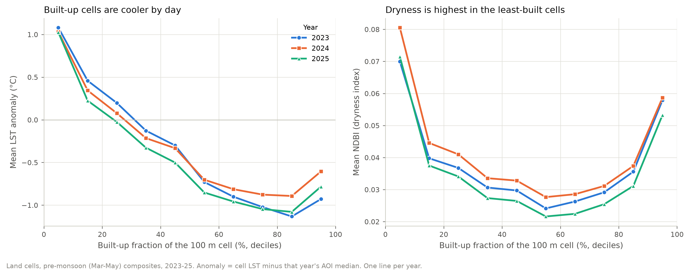{width=88%}
:::

**Distribution and spread.** The anomaly is close to symmetric in every year,
with a standard deviation of 3.67, 3.23 and 3.37 °C over land cells in 2023,
2024 and 2025 and extremes of roughly −16 to +14 °C, the cold tail coming from
riparian vegetation and reservoir edges. A model that predicts the mean has an
RMSE of about 3.4 °C, which is the floor every learner has to beat. Fig. 4
shows why the anomaly, not absolute LST, is the target: the three seasons are
offset by up to 1.8 °C in level but have almost the same shape once each year's
median is removed.

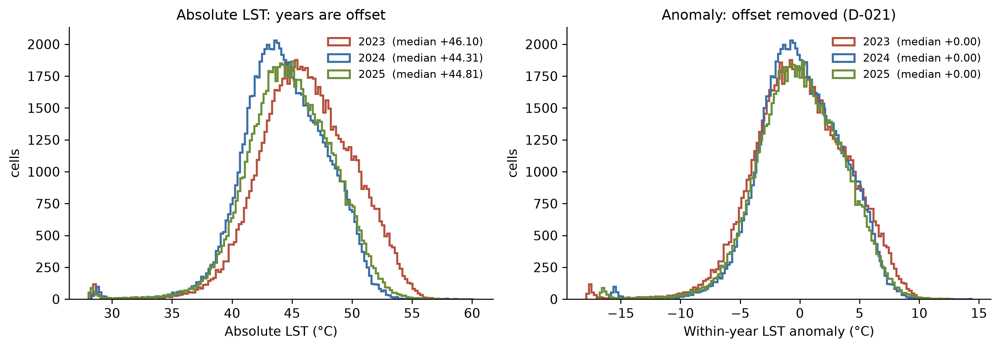{width=100%}

**Correlations.** Fig. 5 shows the pooled correlation matrix from the
exploratory phase, computed before water cells were removed. On land cells the
strongest single correlates of the anomaly are the dryness index (+0.70), grass
fraction (+0.61), NDVI (−0.61) and tree fraction (−0.54), while built-up
fraction is weakly *negative* (−0.24). The three spectral indices are strongly
correlated with each other: NDVI and the dryness index at r = −0.72, and the
variance inflation factors of NDVI, dryness and moisture are 29.8, 18.4 and
18.8 in the linear feature set. Their individual linear coefficients are
therefore unstable and must be read as a block, a point that recurs in
Section XIII.

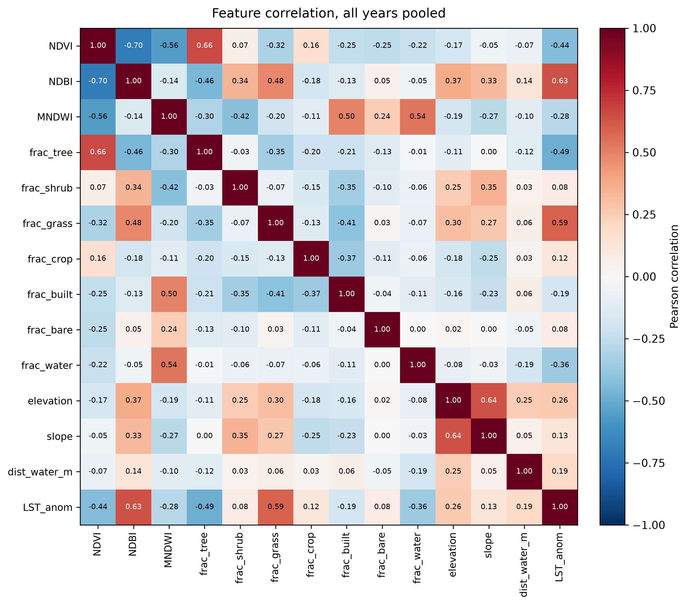{width=96%}

**Within urban cells** the picture changes: the correlation of moisture with
the anomaly turns positive and that of built-up fraction vanishes, while grass
and NDVI keep their signs. Drivers that matter across the whole area therefore
need not matter within the city, which is why results are reported for urban
cells separately throughout.

# Feature Engineering

The model uses 13 features in three groups (Table III).

**Spectral indices.** From Sentinel-2 bands B3 (green), B4 (red), B8 (NIR) and
B11 (SWIR1),

::: eq
$$\text{NDVI} = \frac{B8 - B4}{B8 + B4},$$
:::

::: eq
$$\text{NDBI} = \frac{B11 - B8}{B11 + B8},$$
:::

::: eq
$$\text{MNDWI} = \frac{B3 - B11}{B3 + B11}.$$
:::

NDBI was designed as a built-up index [23], but on this grid it tracks
surface *dryness*: dry grass, fallow fields and bare soil score as high as
roofs. It is therefore called the **dryness index** throughout. MNDWI [24] is
used on land as a **moisture index**. This is a substantive interpretive
choice, not a renaming: read as "built-up", NDBI would invert the story of
Section XIII.

**Land-cover fractions.** The seven WorldCover fractions describe the
composition of each cell. Linear regression drops the built-up fraction as its
reference category, since the fractions sum to one; dropping the
highest-variance fraction removes the exact collinearity most effectively. The
tree models keep all seven.

**Terrain and proximity.** Elevation and slope come from SRTM; distance to the
nearest water pixel is computed on a 30 m grid and capped at about 7.7 km.

**Excluded columns.** Coordinates (longitude, latitude, UTM easting and
northing), block identifiers and the observation count are declared forbidden
in the configuration, and an assertion stops the pipeline if any reaches a
model. No year indicator is used, so the 2025 test cannot exploit a level
shift.

::: lefttable
| Group | Feature | Description |
|---|---|---|
| Spectral | NDVI | Greenness (Sentinel-2) |
| Spectral | Dryness (NDBI) | SWIR–NIR contrast; high for dry, bare, fallow surfaces |
| Spectral | Moisture (MNDWI) | Green–SWIR contrast; surface moisture on land |
| Land cover | frac_tree, shrub, grass, crop, built, bare, water | Share of the cell in each WorldCover class |
| Terrain | Elevation, slope | SRTM |
| Proximity | Distance to water | Metres to the nearest water pixel |

: Table III. The 13 model features. Coordinates and block identifiers are never features.
:::

# Model Development

## Learners

Five models are compared on identical folds:

- a **mean baseline** (scikit-learn `DummyRegressor`), the floor;
- **linear regression**, standardised inside a scikit-learn pipeline
  [18], the linear status quo of the UHI literature;
- **Random Forest** [14], a bagged tree ensemble;
- **XGBoost** [15] with the histogram tree method;
- **LightGBM** [16], a leaf-wise gradient-boosted tree ensemble.

## Validation design

Three schemes are compared, all with 5 folds:

- **Random CV, grouped by cell:** a cell's three years stay together, so this
  isolates spatial leakage from repeated-measurement leakage.
- **Spatial block CV:** square blocks of 1, 2, 4 or 8 km are held out whole
  [3], [17].
- **Spatio-temporal CV:** train on 2023–24 in the training blocks, test on 2025
  in the held-out blocks, so the test is unseen in both space and time.

**Block size** comes from the autocorrelation the model cannot already explain.
The raw anomaly reaches 95% of its sill at about 7.6 km (Fig. 6), but most of
that range is the regional core-to-periphery gradient, which the features
explain. Under 2 km CV, the residual variogram of a default LightGBM reaches 95%
of its sill at 5,050 m (2023), 3,950 m (2024) and 2,350 m (2025). The median,
3,950 m, gives a 4 km primary block. The tuned model's own residuals give a
median of 4,250 m. We kept the pre-registered protocol rather than re-measure
under a different one, because the measured range grows with the block size
used to generate the residuals (3,450 m under random CV to 5,250 m under 8 km
CV). The 8 km results are reported as the conservative bound.

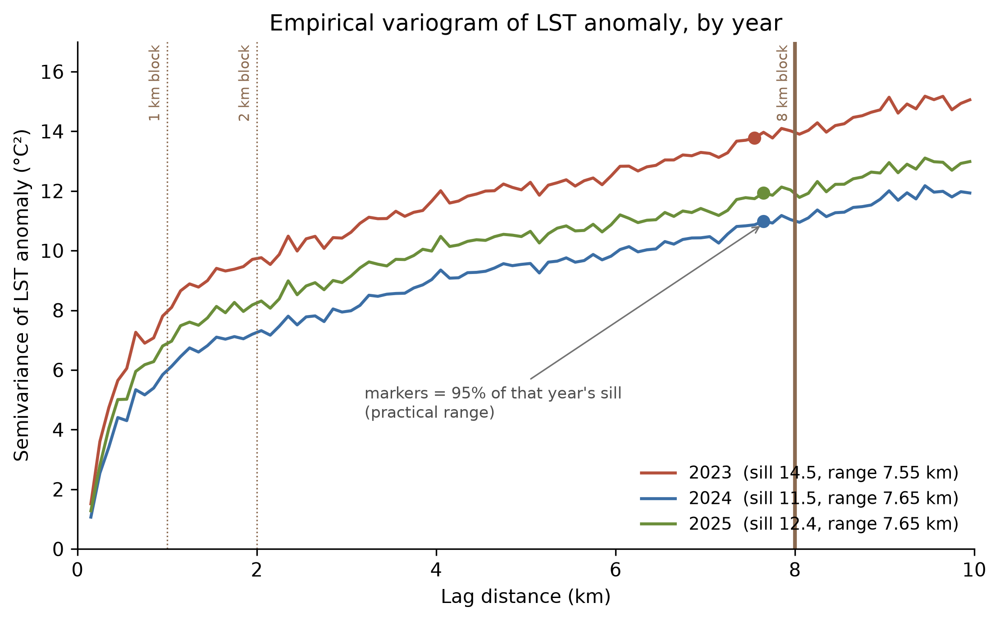{width=100%}

**Fold layout.** An early check found that unshuffled block assignment produced
east-west strip folds, because block identifiers are ordered by column. So
blocks are dealt to folds at random, repeated over five seeds (42–46), and
every result is the mean ± standard deviation over all 25 seed × fold runs.
The strip layout is kept as a stress test of extrapolating across latitude.
Fig. 7 shows an 8 km layout and why fold composition varies: urban cells are
centrally concentrated with ribbon sprawl, so no layout can make every fold
representative. Algorithm 1 states the whole evaluation loop.

::: algo
**Algorithm 1.** Spatial block cross-validation with randomised layouts

1. **Input:** land-cell table $D$ (2023–25), block size $b$, models $\mathcal{M}$, seeds $S = \{42,\dots,46\}$, $K = 5$.
2. Assign each cell to the $b \times b$ km block that contains it; all years of a cell share the block.
3. **for** each seed $s \in S$ **do**
4. Shuffle the block list with seed $s$ and deal blocks to $K$ folds in turn.
5. **for** each fold $k$ and each model $m \in \mathcal{M}$ **do**
6. Fit $m$ (with any scaling) on rows outside fold $k$; predict rows in fold $k$.
7. Record RMSE, MAE and $R^2$ for $(s, k, m)$; release the fitted model.
8. **Output:** mean ± std over the $|S| \times K = 25$ runs, and paired differences per $(s, k)$.
:::

::: wide
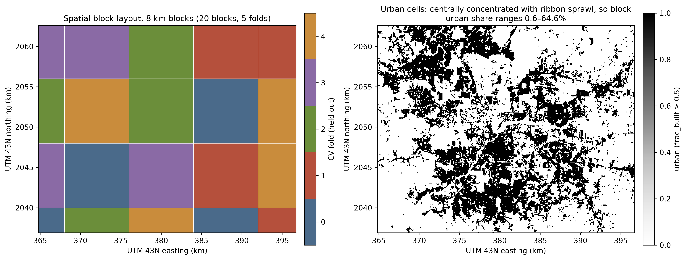{width=80%}
:::

## Training protocol

For each scheme, seed and fold, every model is fitted on the training rows and
predicts the held-out rows, producing out-of-fold predictions for all rows.
Scaling for linear regression is fitted inside the fold. Fitted forests are
released before the next fold, so only one is held in memory at a time.

## Explanation

SHAP values [7] are computed with interventional TreeSHAP
[8] for a LightGBM refitted on all land rows of the three years.
They use a 1,000-row background sample and a 10,000-row sample stratified by
year and urban/rest. Interventional SHAP is used because the features are
strongly correlated.

- **Additivity:** for every row the SHAP values plus the base value must equal
  the model's prediction,
  $f(\mathbf{x}) = \phi_0 + \sum_{k=1}^{13} \phi_k(\mathbf{x})$; the check
  exposed a float32 rounding issue that is now fixed.
- **Robustness:** XGBoost is explained on the same rows, and path-dependent
  SHAP is compared with interventional SHAP.
- **Driver groups:** because the indices trade credit, the per-cell map uses
  groups (spectral, dry cover, tree cover, terrain, water proximity, built),
  whose SHAP is the sum of the members'.
- **Thresholds:** fitted as one-knot segmented regressions with bootstrap
  confidence intervals. Land-cover fractions with many zero cells are split
  into a step at zero and a fit on positive values.
- **Interactions:** use path-dependent SHAP interaction values, since no
  interventional algorithm exists.

## Greening scenarios

The targets are urban cells (built-up ≥ 50%) in the hottest decile of their
*observed* 2023–25 mean anomaly. Selecting on observed rather than predicted
heat avoids depending on the model's 54% precision at finding the hottest urban
cells. Three scenarios are simulated: (A) +10 points of tree cover; (B) +20
points; (C) raise tree cover to the fitted 10.2% knot. The new cover is taken
from built, bare and grass in proportion to their shares, so the fractions
still sum to one. The **lower bound** changes the fractions only and holds the
spectral indices fixed; the **realistic bound** also moves each index by the
change that a spatially validated land-cover-to-index model predicts. Every
scenario runs through tuned LightGBM, XGBoost and RF, is averaged over the
three years, and is checked against a nearest-neighbour test of whether the
edited cells resemble real cells in the training data.

# Hyperparameter Tuning

Hyperparameters are tuned by randomised search with 25 candidates per model,
scored on negative RMSE, inside spatial CV on the seed-42 4 km layout. The
layout is computed on the full 2023–24 table and carried into a 60,000-row
subsample as explicit splits, so the tuning folds are exactly the evaluation
folds of that seed. The search uses 2023–24 rows only, so the 2025 test was
never seen during selection. The search spaces are:

- **Random Forest:** 200–500 trees, depth 8–20, minimum leaf size 1–20,
  feature fraction 0.3–0.7;
- **XGBoost:** 300–1,200 trees, depth 4–10, learning rate 0.01–0.1, row and
  column subsampling 0.6–1.0, minimum child weight 1–20, L2 penalty 0.1–10;
- **LightGBM:** 300–1,200 trees, 15–127 leaves, learning rate 0.01–0.1,
  minimum child samples 10–100, row and column subsampling 0.6–1.0, L2 penalty
  0.1–10.

Table IV gives the selected settings. All three boosted or bagged models
converge on large, slowly learning ensembles, and their tuning RMSEs differ by
less than 0.02 °C, an early sign of the tie reported in Section XIII.

| Model | Selected hyperparameters | Tuning RMSE (°C) |
|---|---|---|
| LightGBM | n_estimators 1200, learning_rate 0.01, num_leaves 63, min_child_samples 10, subsample 0.8, colsample_bytree 0.6, reg_lambda 1.0 | 1.7505 |
| XGBoost | n_estimators 1200, learning_rate 0.01, max_depth 8, min_child_weight 20, subsample 0.8, colsample_bytree 0.8, reg_lambda 1.0 | 1.7498 |
| Random Forest | n_estimators 200, max_depth 16, min_samples_leaf 2, max_features 0.3 | 1.7674 |

: Table IV. Tuned hyperparameters (all other settings are library defaults, seed 42, CPU execution).

Because selection used the same seed-42 folds that later report spatial-CV
scores, those scores are mildly optimistic for that seed. A nested CV would
remove the bias at five times the cost; instead, the spatio-temporal 2025 test,
which neither tuning nor block choice touched, serves as the clean check.

# Evaluation Metrics

For $n$ held-out cells with observed anomaly $y_i$, prediction $\hat{y}_i$ and
mean $\bar{y}$, the primary metric is the root-mean-square error, reported with
the mean absolute error and the coefficient of determination:

::: eq
$$\text{RMSE} = \sqrt{\tfrac{1}{n}\textstyle\sum_{i}(y_i-\hat{y}_i)^2},\quad \text{MAE} = \tfrac{1}{n}\textstyle\sum_{i}\lvert y_i-\hat{y}_i\rvert,$$
:::

::: eq
$$R^2 = 1 - \frac{\sum_i (y_i-\hat{y}_i)^2}{\sum_i (y_i-\bar{y})^2}.$$
:::

RMSE is in °C, the target's own unit, and penalises large misses, which matter
for locating hot spots. Each metric is computed per fold and reported as mean ±
standard deviation over 25 runs (5 seeds × 5 folds). Four diagnostics
complement it:

- **Paired differences:** model-minus-reference RMSE on identical (seed, fold)
  pairs, so a tie is visible as a tie.
- **CV gap:** RMSE under spatial CV minus RMSE under random CV, the measure of
  RQ3.
- **Hottest-decile detection:** the share of the observed hottest 10% of cells
  that is also in the predicted hottest 10% (chance is 10%).
- **Residual Moran's I** [25] on 100 m queen neighbours,

::: eq
$$I = \frac{n}{\sum_{i}\sum_{j} w_{ij}}\,\frac{\sum_{i}\sum_{j} w_{ij}\,e_i e_j}{\sum_{i} e_i^2},$$
:::

where $e_i$ are mean-centred residuals and $w_{ij}=1$ for neighbouring cells;
values near 0 mean the features explain the spatial structure, values near 1
mean they do not.

# Experimental Results

## Model comparison

Table V and Fig. 8 compare the models. Under random CV, XGBoost is clearly
best (1.594 °C, better than LightGBM in all 25 paired runs). Once test areas
are unseen, that lead disappears. At 4 km the three tree models are tied
(LightGBM 1.746 ± 0.060, XGBoost 1.746 ± 0.064, RF 1.756 ± 0.059 °C), and the
paired XGBoost-LightGBM difference is −0.000 ± 0.006 °C. LightGBM is used as
the reference model because it is lowest on the clean 2025 test and the
cheapest to explain, not because it is more accurate.

::: wide
| Model | Random CV | Spatial 4 km | R² (4 km) | Spatio-temporal 2025 | R² (2025) |
|-------------------|---------------------|---------------------|----------|---------------------|----------|
| Baseline (mean) | 3.428 ± 0.015 | 3.451 ± 0.187 | −0.042 | 3.392 ± 0.210 | −0.044 |
| Linear regression | 1.849 ± 0.010 | 1.873 ± 0.047 | 0.691 | 1.897 ± 0.138 | 0.670 |
| Random Forest | 1.637 ± 0.008 | 1.756 ± 0.059 | 0.728 | 1.749 ± 0.107 | 0.721 |
| XGBoost | 1.594 ± 0.009 | 1.746 ± 0.064 | 0.732 | 1.750 ± 0.109 | 0.720 |
| LightGBM | 1.620 ± 0.009 | 1.746 ± 0.060 | 0.732 | 1.747 ± 0.108 | 0.721 |

: Table V. RMSE of the LST anomaly (°C, mean ± std over 5 seeds × 5 folds) and R² under each validation scheme.
:::

::: wide
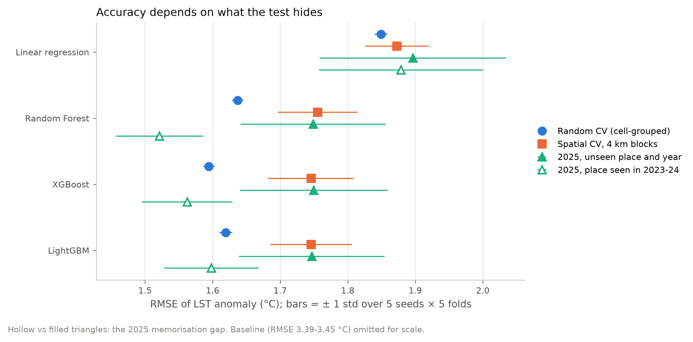{width=70%}
:::

## How much random CV overstates accuracy (RQ3)

Fig. 9 plots error against block size. With the fold layout controlled, error
rises steadily with block size. For LightGBM, RMSE goes from 1.620 °C (random)
to 1.675, 1.706, 1.746 and 1.840 °C at 1, 2, 4 and 8 km, and R² falls from 0.777
to 0.685.

**The inflation depends on the model.** From random to 4 km CV, the trees lose
0.118 (RF), 0.126 (LightGBM) and 0.151 °C (XGBoost), i.e. +7.2% to +9.5%.
Linear regression loses only 0.023 °C (+1.3%). The more flexible the model, the
more local, place-specific structure random CV rewards. Comparing models under
random CV therefore favours the most flexible one, not only the absolute
scores.

The east-west strip layout costs LightGBM a further 0.016 °C
(1.762 ± 0.113 against 1.746 ± 0.060 °C). It nearly doubles the fold spread, but
it does not change any conclusion.

::: wide
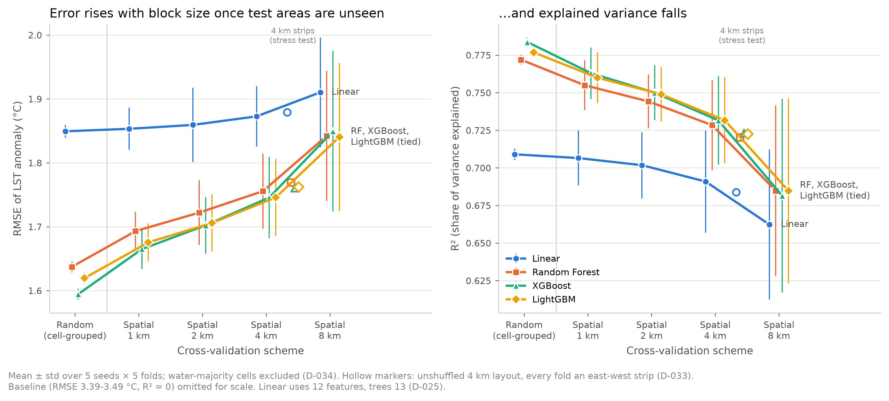{width=86%}
:::

## The 2025 test and the cost of memorising places

On 2025, in blocks never seen in training, LightGBM scores 1.747 ± 0.108 °C
(R² 0.721). Scored on the same rows, a model that had seen those *places* in
2023–24 reaches 1.598 °C (R² 0.767). That memorisation gap is 0.149 °C for
LightGBM, 0.187 °C for XGBoost, 0.227 °C for RF and 0.018 °C for linear
regression (Fig. 8): the same model-dependent pattern as RQ3. A pure temporal
holdout on the same cells would have reported R² ≈ 0.77 for the wrong reason.
That is why the spatio-temporal design replaced it. Fig. 10 shows that the
out-of-fold predictions follow the 1:1 line in both designs, with mild
shrinkage of the most extreme anomalies toward the mean.

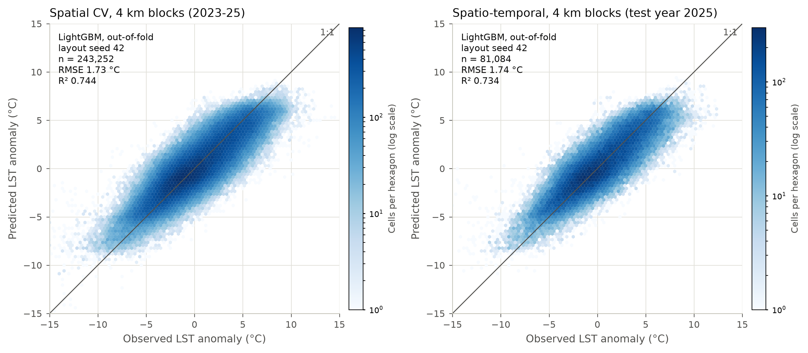{width=100%}

## Where the errors are

**Urban vs rest.** Urban cells have lower error but also lower R². At 4 km,
LightGBM's RMSE is 1.614 °C in urban cells against 1.805 °C elsewhere, but R²
is 0.542 against 0.753. The urban anomaly range is narrower (baseline RMSE
2.662 against 3.771 °C), so the same error is a larger share of it. Urban
performance is therefore quoted in °C.

**Hottest cells.** 62.3% of the observed hottest tenth of cells is also in the
predicted hottest tenth, and 54.2% within urban cells (chance is 10%).

**Spatial structure.** The residuals remain spatially clustered (Fig. 11).
Moran's I [25] on 100 m queen neighbours is 0.583–0.651 for LightGBM at
4 km, against 0.889–0.898 for the raw anomaly. The features explain about a
third of the neighbour-to-neighbour similarity.

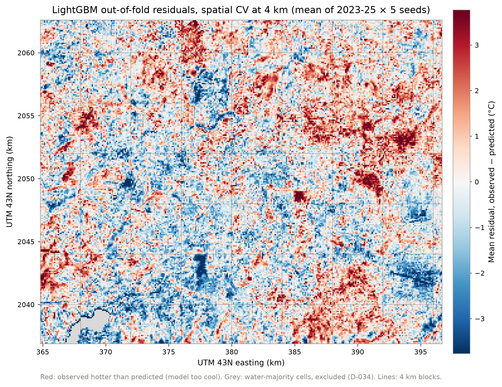{width=100%}

## Drivers (RQ1)

Fig. 12 and Table VI summarise the SHAP attribution. The model's predictions
are associated most strongly with the spectral indices:

- **NDVI:** mean |SHAP| 0.955 °C;
- **dryness index:** 0.728 °C;
- **moisture index:** 0.612 °C.

Summed per cell, the spectral block contributes 1.488 °C, 2.75 times the next
driver. 35% of the indices' separate contributions cancel within the block,
because they carry overlapping signal. Next come grass fraction (0.541 °C) and
cropland (0.342 °C), which are associated with warmer pre-monsoon surfaces, and
tree cover (0.382 °C), associated with cooler ones. Then terrain: elevation
0.253 °C, slope and distance to water 0.156 °C each. Built-up fraction ranks
only 10th (0.125 °C).

XGBoost gives the same ranking: Spearman 0.989 over all cells and 0.973 over
urban cells, with the same top five, but the order of the three indices differs
between the models. In urban cells, moisture rises almost to NDVI's weight
(0.797 against 0.819 °C), and built-up fraction moves up to 8th.

| Driver | All cells (°C) | Urban cells (°C) | Rank, all / urban |
|---|---|---|---|
| NDVI | 0.955 | 0.819 | 1 / 1 |
| Dryness index (NDBI) | 0.728 | 0.539 | 2 / 3 |
| Moisture index (MNDWI) | 0.612 | 0.797 | 3 / 2 |
| Grass fraction | 0.541 | 0.535 | 4 / 4 |
| Tree cover fraction | 0.382 | 0.305 | 5 / 5 |
| Cropland fraction | 0.342 | 0.289 | 6 / 6 |
| Elevation | 0.253 | 0.226 | 7 / 7 |
| Built-up fraction | 0.125 | 0.167 | 10 / 8 |
| Spectral block (sum of the three indices) | 1.488 | 1.022 | — |

: Table VI. Mean |SHAP| (°C of LST anomaly), LightGBM, 10,000 stratified cell-years (3,297 urban).

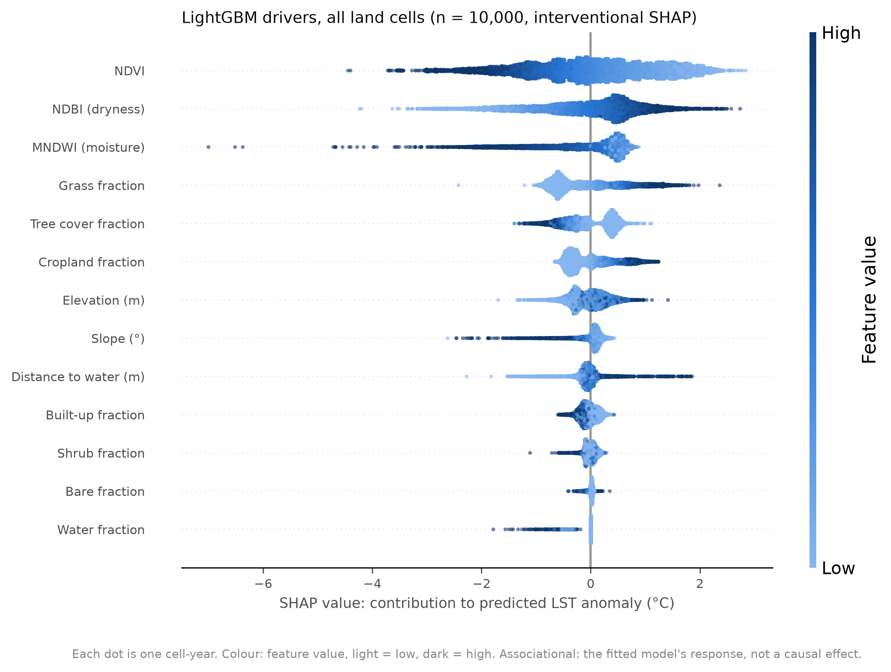{width=100%}

The individual indices trade credit between models and SHAP methods, so the
per-cell map uses driver *groups* (Fig. 14). The dominant group is the same
under XGBoost for 95.3% of rows, against 79.1% at feature level. Spectral
drivers dominate 66.8% of cells, and dry cover (grass, crop, bare, shrub) 24.5%,
rising to 42.7% of urban cells. Fig. 13 ranks the groups: the spectral
block leads, followed by dry cover, tree cover and terrain. Built-up fraction
is last over all cells and fifth in urban cells, where dry cover comes closest
to the spectral block.

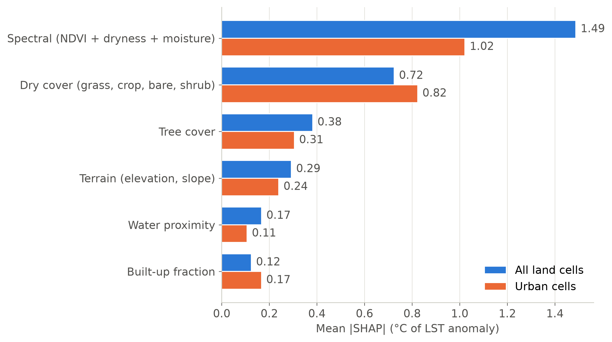{width=100%}

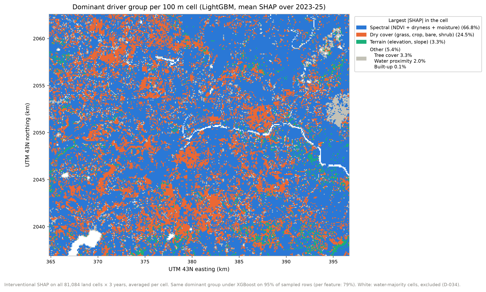{width=100%}

## Thresholds and nonlinearity (RQ2)

The trees capture three things the linear model misses.

**Thresholds and saturation.** Tree cover (Fig. 16) shows a step of −0.48 °C
at first canopy, then about −0.25 °C per 10 points up to a knot at 10.2% (95% CI
9.6–10.6%), and only −0.07 °C per 10 points beyond. For tree cover, a straight
line explains 69% of the SHAP variation and the one-knot fit 95%. The other
bends:

- the moisture index has no association below −0.39, then −1.4 °C per +0.1;
- NDVI is associated with −1.2 °C per +0.1 below 0.27 and −0.7 °C above;
- the cooling associated with water reaches about 190 m and is flat beyond;
- the elevation association flattens above 590 m.

Fig. 15 shows these shapes for the four strongest features, with the
linear model's contribution drawn on the same scale for comparison.

::: wide
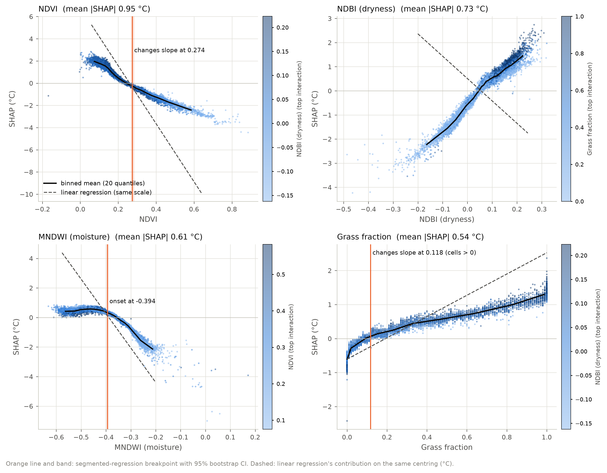{width=74%}
:::

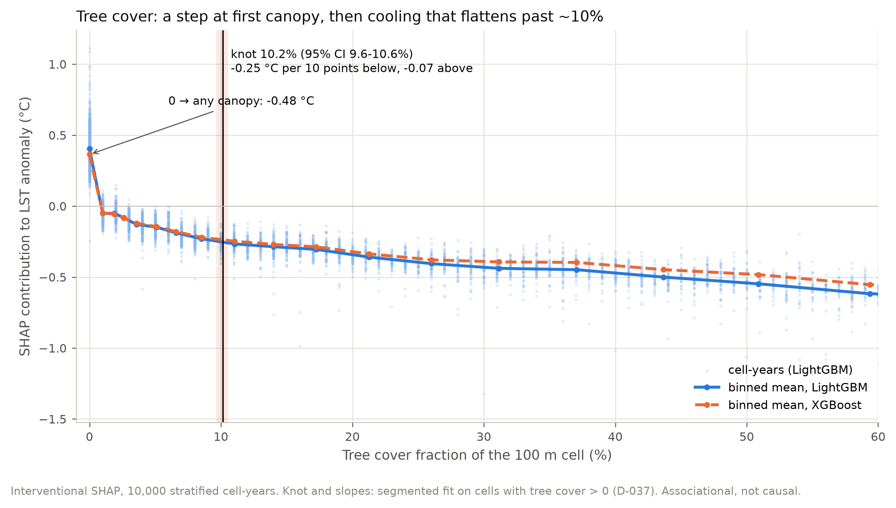{width=100%}

**Interactions.** The largest are within the dryness-vegetation system:
dryness × grass (0.179 °C), NDVI × dryness (0.165 °C) and NDVI × moisture
(0.145 °C).

**Collinearity.** Linear regression splits the spectral signal differently from
the trees. Its standardised dryness coefficient is −0.84 °C per standard
deviation, opposite in sign to both the raw correlation (+0.70) and the trees'
response (+0.90 °C per SD), and its NDVI coefficient is inflated to −3.33
against −1.15 °C per SD. Its spectral-block total still tracks the trees'
(r = 0.96). So individual linear coefficients of collinear indices cannot be
read as driver effects. Together these differences cost linear regression
0.13 °C of spatial-CV RMSE.

## The built-up association (RQ5)

Raw, built-up fraction correlates with the anomaly at r = −0.24, which is
−0.22 °C per +10 points: a cool-island association. With vegetation, dryness,
moisture, land cover and terrain in the model, the response attributed to
built-up fraction shrinks to −0.029 °C per +10 points, 87% smaller. It does not
flip to warming. Within urban cells the raw association is already nil
(r = +0.009), and the small negative attribution there is model-dependent:
XGBoost gives built-up fraction half LightGBM's weight. So most of the
association is carried by vegetation and dryness. In the pre-monsoon, the built
core is less dry than the grass, cropland and bare land around it. It is not a
cooling effect of building.

## Greening scenarios (RQ4)

**Targets.** The targets are 2,673 of 26,726 urban cells, those with an observed
mean anomaly of at least +2.41 °C. They lie on the urban fringe: 45% to the
north-east and 29% to the south-east, a median 11.5 km from the centre
(Fig. 17). Their median built-up is 78% and median tree cover 0.0%. 78.7% have
no tree cover at all.

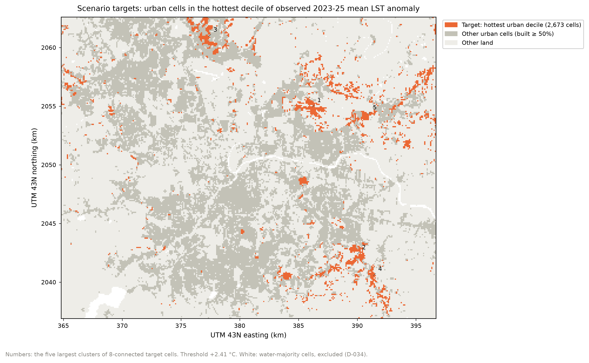{width=100%}

**Index models.** The land-cover-to-index models behind the realistic bound
reach spatial-CV R² of 0.716 (moisture), 0.668 (NDVI) and 0.614 (dryness).

**Results.** Table VII gives the headline as a bracket from lower to realistic
bound. It excludes the step from no canopy to any canopy, which is reported
separately below. Raising the targets to about 10% tree cover is associated
with 0.35–0.97 °C (scenario C) or 0.37–1.02 °C (+10 points) cooler surfaces.
Doubling the addition to +20 points gives 0.56–1.63 °C, about 60% more cooling
for twice the cover. Beyond the first point, gains per point roughly halve past
the knot: −0.12 °C per point (realistic) up to 10.2%, and −0.05 °C from 12% to
30%. The models agree closely (ranges ≤ 0.16 °C). The choice
of bound matters far more, by a factor of about three. Almost no edited
cell falls outside the training data: at most 0.04% of rows, and 0.57% even at
+30 points.

| Scenario | Lower bound (°C) | Realistic bound (°C) |
|---|---|---|
| A: +10 points | −0.37 [−0.42, −0.33] | −1.02 [−1.04, −1.00] |
| B: +20 points | −0.56 [−0.65, −0.49] | −1.63 [−1.67, −1.60] |
| C: to the 10.2% knot (avg. +9.2 points) | −0.35 [−0.38, −0.31] | −0.97 [−1.00, −0.94] |

: Table VII. Mean ΔLST over the target cells, excluding the first point of canopy; mean of three models [model range], averaged over 2023–25.

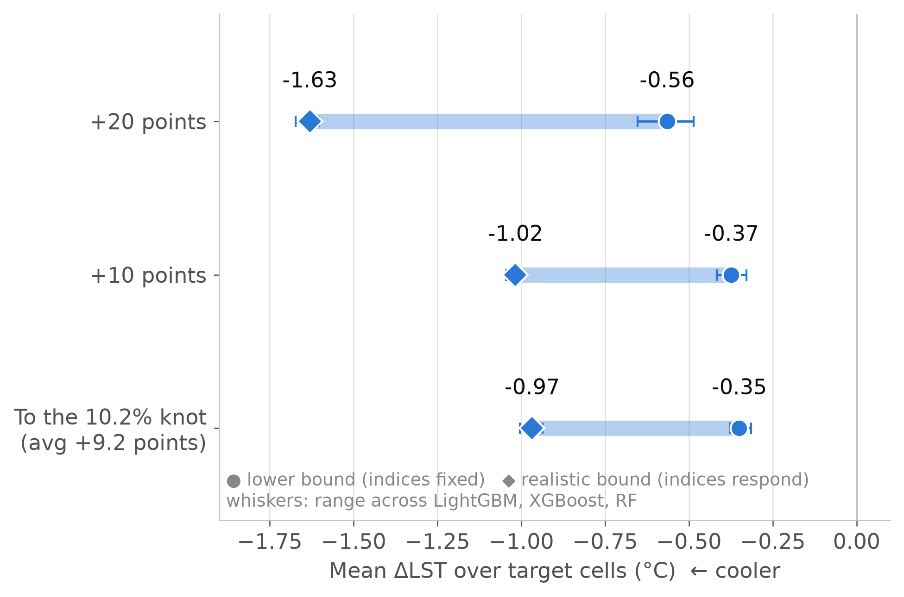{width=92%}

**Tree-less cells.** For the 78.7% of targets with no tree cover, the first
point of canopy, a single 10 m WorldCover tree pixel in the cell, is associated
with −1.43 °C (realistic) or −0.87 °C (lower). One tree pixel in a hectare
cannot plausibly do that. The step is confounded with unobserved urban form,
such as dense new fringe and industrial development. It is reported as a
finding: tree-less urban cells run about 1.4 °C hotter in ways the model cannot
attribute to tree cover alone.

# Visualizations

The figures in this paper are produced by the pipeline from the stored tables
at 300 dpi, with fixed colour conventions: the inferno scale for temperature, a
red–blue diverging scale centred on zero for anomalies, residuals and SHAP
values, and one fixed colour per model across every chart. Maps are drawn on the
100 m grid in UTM coordinates with water cells greyed out, so every map can be
compared cell for cell.

The same results are available in an interactive Streamlit dashboard with nine
pages: project overview, dataset, exploratory maps, models and validation,
evaluation, explainability, interactive prediction, scenario results, and
limitations. The dashboard is read-only: it loads the tables and figures the
pipeline wrote, through a small tested module, so it cannot show a number that
disagrees with this paper. Its one live computation is the interactive
prediction page (Fig. 19), where sliders describe a cell, the final LightGBM
predicts its LST anomaly with an exact per-feature breakdown, and a tree-cover
control applies the lower-bound scenario edit.

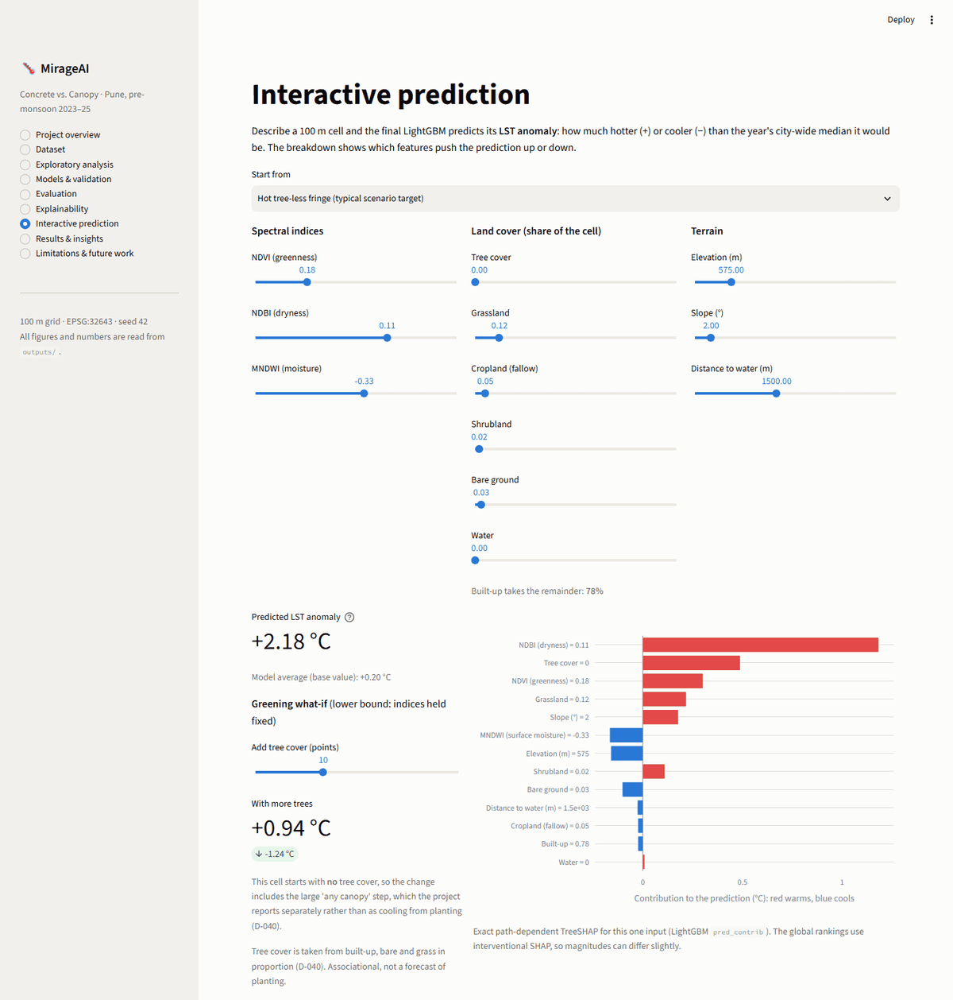{width=100%}

::: wide
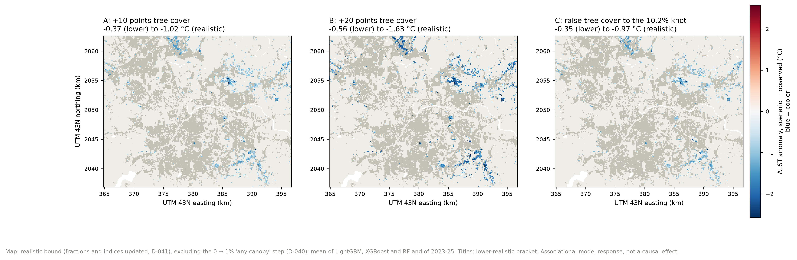{width=92%}
:::

Fig. 20 maps the scenario results. Cooling concentrates in the large
tree-less clusters on the eastern fringe, where both the starting temperature
and the land-cover change are largest.

# Discussion

**An inverted, vegetation-linked cool island.** Pune's daytime pre-monsoon
pattern is a cool island, not a heat island (Fig. 3), consistent with
Shastri et al. [11]. The model attributes it to vegetation, dryness and
moisture rather than to built-up surface itself: the built-up association
shrinks by 87% once those are modelled. For planning, the hottest surfaces are
the dry, tree-less fringe where the city is growing (Fig. 17), not the older
core. This also agrees with the global finding that daytime SUHI intensity is
governed mainly by vegetation and evapotranspiration contrasts [9].

**The dryness index is not a built-up index here.** NDBI correlates +0.70 with
the anomaly but is highest in the least-built cells (Fig. 3). Reading it as
"built-up" would have inverted the story. Labelling it as dryness, and MNDWI as
moisture on land, is a substantive interpretive choice, not just a renaming.

**Validation inflation depends on the model.** The random-vs-spatial gap is not
one number. It is 0.023 °C for linear regression and up to 0.151 °C for XGBoost,
and the place-memorisation gap follows the same order. A comparison under random
CV would have crowned XGBoost. Under spatial and spatio-temporal CV the three
tree models are tied, which is the more honest finding. This extends the
argument of [3] and [4]: random CV does not only inflate the
score, it biases *model selection* toward the model that memorises place best.

**Nonlinearity matters, but mostly at the margins.** The tree models beat
linear regression by about 0.13 °C, and they reveal saturation (tree cover past
about 10%), onsets (moisture) and distance limits (water) that a linear model
cannot express. The linear model's collinear coefficients would also have
mis-signed the dryness effect. For planning, the saturation is the actionable
part: gains per point of canopy roughly halve once a cell reaches about 10–12%
cover.

**Confounding is the main threat to every scenario number.** The models learn
from differences *between* places, and places with more trees also differ in
building height, density, roofing, irrigation and age. The residual Moran's I
of about 0.6 shows that neighbouring cells share an error the features cannot
see. The tree-less step (Section XIII-H) is the clearest symptom. The realistic
bound inherits the confounding twice, once through the LST models and once
through the index models. The scenarios are therefore planning signals about
where greening is most associated with cooler surfaces, not forecasts. This is
in line with reviews that find greening evidence largely observational
[10].

**What the reproducibility work bought.** Three of the results above exist only
because of engineering checks: the shuffled fold layout (strip folds had moved
the headline), the additivity test (float32 rounding), and the identifier test
(merged columns). Each was caught by an assertion before it reached a number in
this paper.

# Limitations

- **Surface, not air.** LST measures the skin temperature seen by the satellite
  at overpass, not air temperature or comfort [1].
- **Cross-sectional associations.** No result is causal (Section XV). There is
  no before-and-after evidence of planting.
- **Unmodelled drivers.** Residual Moran's I ≈ 0.6 points to building height,
  roofing material and irrigation, none of which is available on a consistent
  100 m grid for 2023–25.
- **Static land cover.** WorldCover 2021 is used for all three years. Land-cover
  change between 2021 and 2025 is not represented.
- **Block-size judgement.** The 4 km block rests on a pre-registered residual
  range of 3,950 m. The tuned model's residuals give 4,250 m, so 8 km results
  are reported as the conservative bound.
- **Mildly optimistic tuning.** Hyperparameters were chosen on the seed-42
  spatial layout, which slightly flatters that layout's scores. The 2025
  spatio-temporal test is untouched by selection.
- **SHAP depends on the method for correlated features.** The order of the
  three indices changes between SHAP methods and models; only the block and the
  groups are robust.
- **Scenario realism.** Tree cover replaces built, bare and grass in proportion,
  which is a modelling convention, not a design, and the index response comes
  from cross-sectional models with R² 0.61–0.72.
- **One city, one season, daytime only.** The cool island may not hold at night
  or after the monsoon [11].

# Future Work

- **Missing urban-form drivers:** add building height and density, roof
  material and irrigated green space, which the residual structure points to.
- **Neighbourhood features:** focal means of land cover would capture heat that
  spreads between neighbouring surfaces.
- **Air temperature:** pair LST with ground or mobile air-temperature data to
  test whether surface associations carry over to air.
- **Before-and-after evidence:** use multi-year land-cover change (planting and
  clearing) to move from cross-sectional to temporal comparisons.
- **Seasons and night:** extend to night-time and post-monsoon composites,
  where the heat island may not be inverted.
- **Nested spatial CV:** remove the small tuning optimism at the cost of a
  five-fold increase in compute.
- **Live scenarios:** expose the realistic-bound scenario in the dashboard by
  shipping the index models.

# Conclusion

Table VIII summarises the answers to the five research questions.

::: lefttable
| RQ | Answer |
|---|---|
| RQ1: drivers | Vegetation, dryness and moisture lead (spectral block 1.488 °C mean \|SHAP\|), then grass, tree cover, cropland and terrain; built-up fraction ranks 10th of 13. |
| RQ2: nonlinearity | Yes: tree cover saturates past about 10%, moisture has an onset, water's reach ends near 190 m; the trees beat linear regression by about 0.13 °C under spatial CV. |
| RQ3: CV inflation | 0.12–0.15 °C RMSE (+7.2% to +9.5%) for the tree models, 0.023 °C for linear regression; random CV also changes which model looks best. |
| RQ4: greening | Raising tree cover to about 10%: 0.35–0.97 °C cooler; +10 points: 0.37–1.02 °C; +20 points: 0.56–1.63 °C (lower to realistic bound). |
| RQ5: cool island | Yes: the core is 3.4–4.0 °C cooler than the outer ring. The built-up association shrinks by 87% under control but does not vanish or flip. |

: Table VIII. Answers to the research questions (associations, not causal effects).
:::

Pune's pre-monsoon daytime surfaces are cooler in the built city than in its
dry periphery. Spatially validated machine learning can map the anomaly to
about 1.75 °C RMSE (R² ≈ 0.72) in places and a year it has never seen. Random
validation overstates that accuracy by 0.12–0.15 °C for tree models, and it
changes which model looks best. The associations the models learn are led by
vegetation, dryness and moisture, with a tree-cover response that flattens past
about 10%. For the 2,673 hottest urban cells, mostly tree-sparse fringe
development on the eastern edge, raising tree cover to about 10% is associated
with 0.4–1.0 °C cooler daytime surfaces, with gains per point roughly halving
beyond about 10–12% cover. These are cross-sectional associations, not measured
effects of planting. The pipeline, data-extraction code, decision log and an
interactive dashboard are released so that every number can be traced and
reproduced.

# Appendix: Reproducibility {.unnumbered}

The code is a Python 3.11 package (`mirageai`) with one driver script per
phase and a single entry point. Its direct dependencies are pinned in
`requirements.txt`, and `requirements-lock.txt` pins the full resolved
environment; the core libraries are scikit-learn 1.9.1, XGBoost 3.2.0,
LightGBM 4.7.0, SHAP 0.51.0, pandas 3.0.6, rasterio 1.4.4 and the Earth Engine
API 1.7.47, with Streamlit 1.65.0 for the dashboard. From the repository root:

::: lefttable
| Step | Command |
|---|---|
| Install | `pip install -r requirements.txt`, then `pip install -e .` |
| Tests | `python -m pytest -q` |
| Dashboard | `streamlit run app.py` |
| Full rebuild | `python scripts/pipeline/run_all.py` |
| Number check | `python scripts/check_report_numbers.py` |
| This paper | `python scripts/build_report.py` |

: Table IX. Commands that reproduce the results, the dashboard and this paper.
:::

The full rebuild needs the Earth Engine exports in `data/raw/` and takes about
an hour on a laptop CPU. The number check recomputes every quoted value in this
paper, the slides and the viva notes from the output tables, and the paper's
build stops if any value disagrees. The decision log (`docs/DECISIONS.md`)
records each methodological choice with the alternatives that were rejected.

# Acknowledgment {.unnumbered}

This work was carried out as a case study for the course *Applications and Use
Cases of Machine Learning* (TE7483) at the Symbiosis Institute of Technology,
Pune. The authors thank the course faculty for their guidance, and the USGS,
ESA, NASA and Google Earth Engine teams for open access to the data used here.

# References {.unnumbered}

::: references
[1] J. A. Voogt and T. R. Oke, "Thermal remote sensing of urban climates," *Remote Sens. Environ.*, vol. 86, no. 3, pp. 370–384, 2003, doi: 10.1016/S0034-4257(03)00079-8.

[2] Q. Weng, D. Lu, and J. Schubring, "Estimation of land surface temperature–vegetation abundance relationship for urban heat island studies," *Remote Sens. Environ.*, vol. 89, no. 4, pp. 467–483, 2004, doi: 10.1016/j.rse.2003.11.005.

[3] D. R. Roberts *et al.*, "Cross-validation strategies for data with temporal, spatial, hierarchical, or phylogenetic structure," *Ecography*, vol. 40, no. 8, pp. 913–929, 2017, doi: 10.1111/ecog.02881.

[4] P. Ploton *et al.*, "Spatial validation reveals poor predictive performance of large-scale ecological mapping models," *Nature Commun.*, vol. 11, 2020, Art. no. 4540, doi: 10.1038/s41467-020-18321-y.

[5] H. Meyer, C. Reudenbach, S. Wöllauer, and T. Nauss, "Importance of spatial predictor variable selection in machine learning applications—Moving from data reproduction to spatial prediction," *Ecol. Model.*, vol. 411, 2019, Art. no. 108815, doi: 10.1016/j.ecolmodel.2019.108815.

[6] N. Gorelick, M. Hancher, M. Dixon, S. Ilyushchenko, D. Thau, and R. Moore, "Google Earth Engine: Planetary-scale geospatial analysis for everyone," *Remote Sens. Environ.*, vol. 202, pp. 18–27, 2017, doi: 10.1016/j.rse.2017.06.031.

[7] S. M. Lundberg and S.-I. Lee, "A unified approach to interpreting model predictions," in *Advances in Neural Information Processing Systems 30*, 2017, pp. 4765–4774, doi: 10.48550/arXiv.1705.07874.

[8] S. M. Lundberg *et al.*, "From local explanations to global understanding with explainable AI for trees," *Nature Mach. Intell.*, vol. 2, no. 1, pp. 56–67, 2020, doi: 10.1038/s42256-019-0138-9.

[9] S. Peng *et al.*, "Surface urban heat island across 419 global big cities," *Environ. Sci. Technol.*, vol. 46, no. 2, pp. 696–703, 2012, doi: 10.1021/es2030438.

[10] D. E. Bowler, L. Buyung-Ali, T. M. Knight, and A. S. Pullin, "Urban greening to cool towns and cities: A systematic review of the empirical evidence," *Landscape Urban Plan.*, vol. 97, no. 3, pp. 147–155, 2010, doi: 10.1016/j.landurbplan.2010.05.006.

[11] H. Shastri, B. Barik, S. Ghosh, C. Venkataraman, and P. Sadavarte, "Flip flop of day-night and summer-winter surface urban heat island intensity in India," *Sci. Rep.*, vol. 7, 2017, Art. no. 40178, doi: 10.1038/srep40178.

[12] A. Siddiqui, G. Kushwaha, B. Nikam, S. K. Srivastav, A. Shelar, and P. Kumar, "Analysing the day/night seasonal and annual changes and trends in land surface temperature and surface urban heat island intensity (SUHII) for Indian cities," *Sustain. Cities Soc.*, vol. 75, 2021, Art. no. 103374, doi: 10.1016/j.scs.2021.103374.

[13] P. Mohammad and A. Goswami, "Surface urban heat island variation over major Indian cities across different climatic zone," presented at the *EGU General Assembly 2020*, Online, 2020, Abstract EGU2020-6444, doi: 10.5194/egusphere-egu2020-6444.

[14] L. Breiman, "Random forests," *Mach. Learn.*, vol. 45, no. 1, pp. 5–32, 2001, doi: 10.1023/A:1010933404324.

[15] T. Chen and C. Guestrin, "XGBoost: A scalable tree boosting system," in *Proc. 22nd ACM SIGKDD Int. Conf. Knowl. Discov. Data Min.*, 2016, pp. 785–794, doi: 10.1145/2939672.2939785.

[16] G. Ke *et al.*, "LightGBM: A highly efficient gradient boosting decision tree," in *Advances in Neural Information Processing Systems 30*, 2017, pp. 3146–3154.

[17] R. Valavi, J. Elith, J. J. Lahoz-Monfort, and G. Guillera-Arroita, "blockCV: An R package for generating spatially or environmentally separated folds for k-fold cross-validation of species distribution models," *Methods Ecol. Evol.*, vol. 10, no. 2, pp. 225–232, 2019, doi: 10.1111/2041-210X.13107.

[18] F. Pedregosa *et al.*, "Scikit-learn: Machine learning in Python," *J. Mach. Learn. Res.*, vol. 12, pp. 2825–2830, 2011.

[19] Earth Resources Observation and Science (EROS) Center, "Landsat 8-9 Operational Land Imager / Thermal Infrared Sensor Level-2, Collection 2," U.S. Geological Survey, 2013, dataset, doi: 10.5066/P9OGBGM6.

[20] M. Drusch *et al.*, "Sentinel-2: ESA's optical high-resolution mission for GMES operational services," *Remote Sens. Environ.*, vol. 120, pp. 25–36, 2012, doi: 10.1016/j.rse.2011.11.026.

[21] D. Zanaga *et al.*, "ESA WorldCover 10 m 2021 v200," Zenodo, 2022, dataset, doi: 10.5281/zenodo.7254221.

[22] T. G. Farr *et al.*, "The Shuttle Radar Topography Mission," *Rev. Geophys.*, vol. 45, no. 2, 2007, Art. no. RG2004, doi: 10.1029/2005RG000183.

[23] Y. Zha, J. Gao, and S. Ni, "Use of normalized difference built-up index in automatically mapping urban areas from TM imagery," *Int. J. Remote Sens.*, vol. 24, no. 3, pp. 583–594, 2003, doi: 10.1080/01431160304987.

[24] H. Xu, "Modification of normalised difference water index (NDWI) to enhance open water features in remotely sensed imagery," *Int. J. Remote Sens.*, vol. 27, no. 14, pp. 3025–3033, 2006, doi: 10.1080/01431160600589179.

[25] P. A. P. Moran, "Notes on continuous stochastic phenomena," *Biometrika*, vol. 37, no. 1–2, pp. 17–23, 1950, doi: 10.1093/biomet/37.1-2.17.
:::
